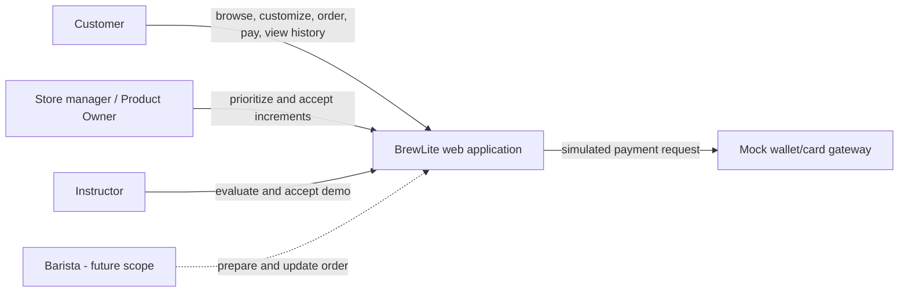
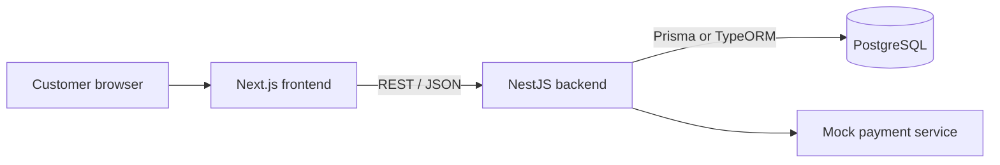
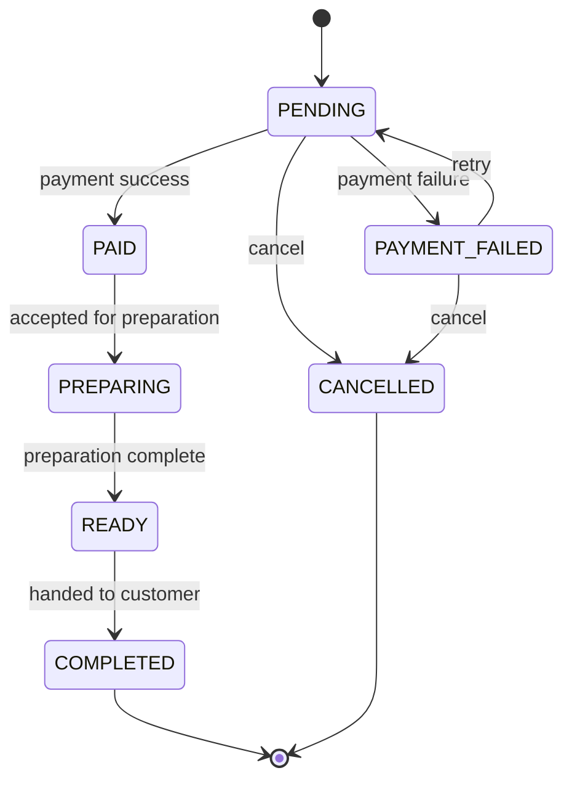
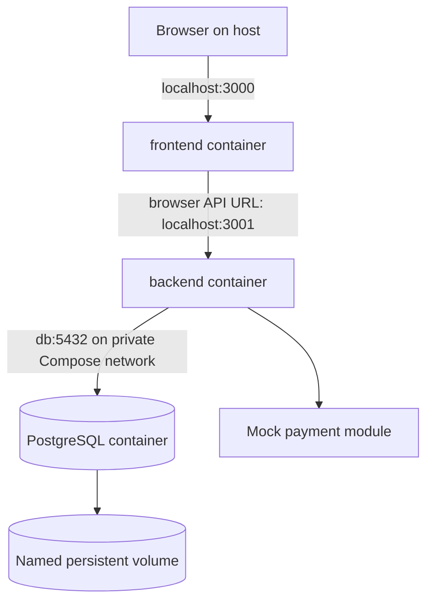

# BrewLite - Diagrams

Diagrams are maintained in Mermaid for review in GitHub and Mermaid-compatible Markdown viewers.

## 1. Use case / system context



## 2. Container architecture



## 3. Order and payment sequence

```mermaid
sequenceDiagram
    actor C as Customer
    participant W as Next.js
    participant A as NestJS API
    participant D as PostgreSQL
    participant P as Mock payment
    C->>W: Configure products and cart
    W->>A: POST /orders (JWT)
    A->>D: Validate stock; create order/items transactionally
    D-->>A: PENDING order + identifier
    A-->>W: Order summary
    W->>A: POST /payments + Idempotency-Key
    A->>D: Look up idempotency key
    alt Key already processed
        D-->>A: Return recorded payment outcome
    else New key
        A->>P: Charge Wallet/Card (mock)
        P-->>A: Success or failure
        A->>D: Record payment and transition order
        opt Payment succeeded
            A->>D: Credit loyalty points once
        end
    end
    A-->>W: Payment outcome + order status
    W-->>C: Confirmation or retry message
```

## 4. Order state machine



Any transition not represented here must be rejected. Cancellation policy and post-payment cancellation, if needed, are open product decisions.

## 5. Deployment topology


