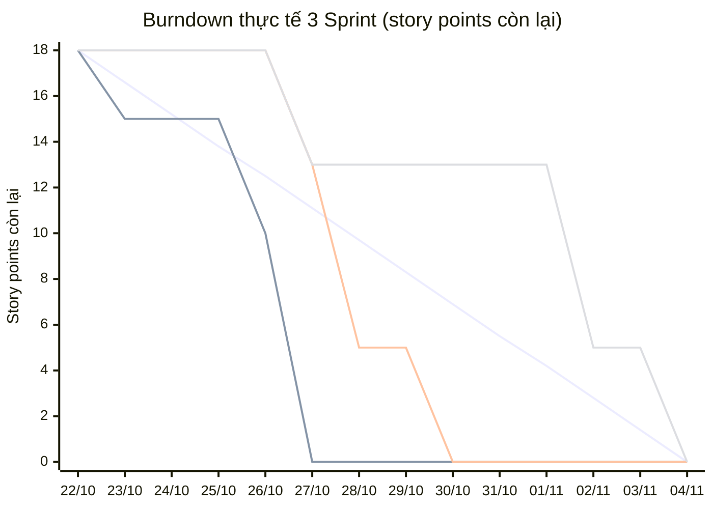
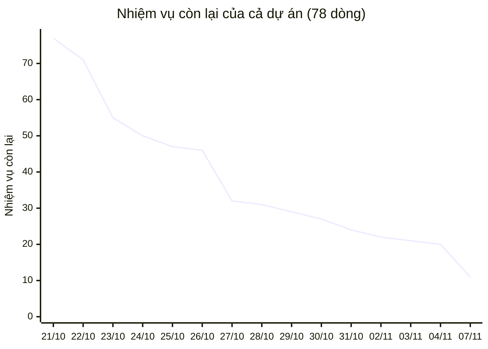

# Task 8 — Kế hoạch 3 Sprint + Sprint Backlog + Burndown chart

**Dự án BrewLite — Sprint 0**

> **Liên kết tài liệu liên quan trong kho lưu trữ (`docs/`):**
> - **Bản vẽ Wireframe 5 màn hình (HTML tương tác — Mục 7 PDF):** [../design/Wireframe-5.html](../design/Wireframe-5.html)
> - **Đặc tả giao diện Wireframe (Markdown):** [../design/wireframes.md](../design/wireframes.md)

---

## 1. Mục đích

Tài liệu này chia 10 task của Product Backlog (Mục 2.3 và Mục 8 trong đề bài `BrewLite-CongNghePhanMem.pdf`) thành 3 Sprint, lập Sprint Backlog chi tiết cho từng Sprint, và Burndown chart (Mục 2.4 trong đề bài) để nhóm theo dõi tiến độ hằng ngày. Ban đầu mục 4 là biểu đồ mẫu; từ ngày 10/11/2026 mục 4 là số liệu thực tế.

---

## 2. Kế hoạch 3 Sprint (Theo Mục 2.3 Đề bài)

| Sprint        | Mục tiêu (Sprint Goal)                    | Task (Product Backlog) | Story Points (Ước lượng nhóm) | Điểm đề bài |
| :------------ | :---------------------------------------- | :--------------------- | :---------------------------: | :---------: |
| **Sprint 1**  | Nền tảng & hiển thị menu                  | Task 1, 2, 3, 4        |              18               |      4      |
| **Sprint 2**  | Giỏ hàng & đặt đơn & đăng nhập            | Task 5, 6, 7           |              18               |      3      |
| **Sprint 3**  | Thanh toán, bàn giao & nghiệp vụ nâng cao | Task 8, 9, 10          |              18               |      3      |
| **Tổng cộng** | **Hoàn thiện MVP BrewLite End-to-End**    | **10 Task**            |            **54**             |   **10**    |

Mỗi Sprint dự kiến kéo dài 1–2 tuần, kết thúc bằng buổi **Sprint Review (Demo)** và **Sprint Retrospective**.

---

## 3. Sprint Backlog chi tiết (Theo Mục 8 Đề bài)

### Sprint 1 — Nền tảng & hiển thị menu (18 Story Points)

| Task       | Tên Task (Story)                 | Yêu cầu / Tiêu chí chấp nhận chính (Theo PDF)                                                                                                 | Story Points |          Người làm          | Trạng thái   |
| :--------- | :------------------------------- | :-------------------------------------------------------------------------------------------------------------------------------------------- | :----------: | :-------------------------: | :----------- |
| **Task 1** | Khởi tạo dự án và cấu trúc       | Tạo monorepo/2 thư mục frontend (Next.js) + backend (NestJS), chạy được "Hello", có `README`, Git, `.env.example`.                            |      3       | H.Tài, Nghĩa, Luân, Bảo Trí | Xong (23/10) |
| 1.1        | Frontend — Khởi tạo Next.js      | Next.js (TypeScript + TailwindCSS), chạy được trang "Hello".                                                                                  |      —       |        Luân, Bảo Trí        | Xong (23/10) |
| 1.2        | Backend — Khởi tạo NestJS        | NestJS kết nối PostgreSQL + Prisma, chạy được "Hello".                                                                                        |      —       |        Nghĩa, H.Tài         | Xong (23/10) |
| 1.3        | Chung — Cấu hình repo            | `.env.example`, `.gitignore`, `README` bản đầu.                                                                                               |      —       |        Nghĩa, H.Tài         | Xong (23/10) |
| **Task 2** | API danh sách sản phẩm           | NestJS `GET /products` trả về JSON menu (`id`, `name`, `price`, `imageUrl`) từ dữ liệu mẫu/CSDL.                                              |      5       |            Nghĩa            | Xong (27/10) |
| 2.1        | Backend — Schema và API sản phẩm | Prisma schema `Product`, migration, seed; `GET /products`, `GET /products/:id`.                                                               |      —       |            Nghĩa            | Xong (27/10) |
| 2.2        | Test (BE) — Unit test sản phẩm   | Unit test `ProductsService` / `ProductsController`.                                                                                           |      —       |            Nghĩa            | Xong (24/10) |
| **Task 3** | Trang Menu (Frontend)            | Next.js gọi `/products`, render lưới sản phẩm, có trạng thái `loading` / `empty state` ([Màn hình 1](../design/Wireframe-5.html)).            |      5       |    Bảo Trí, Luân, P.Tài     | Xong (26/10) |
| 3.1        | Frontend — Lưới sản phẩm         | Component `ProductCard`, lưới sản phẩm trang Menu.                                                                                            |      —       |    Bảo Trí, Luân, P.Tài     | Xong (25/10) |
| 3.2        | Frontend — Gọi API menu          | Gọi `/products`, xử lý trạng thái loading / empty / lỗi.                                                                                      |      —       |        Bảo Trí, Luân        | Xong (26/10) |
| **Task 4** | Chi tiết và tùy chọn sản phẩm    | Màn hình chi tiết: chọn size (`S`/`M`/`L`) và topping (`Trân châu`/`Kem`); tính giá theo tùy chọn ([Màn hình 2](../design/Wireframe-5.html)). |      5       |    Luân, Bảo Trí, P.Tài     | Xong (27/10) |
| 4.1        | Frontend — Trang chi tiết        | Trang chi tiết sản phẩm, chọn size `S`/`M`/`L`.                                                                                               |      —       |    Luân, Bảo Trí, P.Tài     | Xong (27/10) |
| 4.2        | Frontend — Topping và tính giá   | Chọn topping, hàm tính giá theo size/topping.                                                                                                 |      —       |    Luân, Bảo Trí, P.Tài     | Xong (27/10) |

### Sprint 2 — Giỏ hàng & đặt đơn & đăng nhập (18 Story Points)

| Task       | Tên Task (Story)                     | Yêu cầu / Tiêu chí chấp nhận chính (Theo PDF)                                                                                     | Story Points |          Người làm          | Trạng thái   |
| :--------- | :----------------------------------- | :-------------------------------------------------------------------------------------------------------------------------------- | :----------: | :-------------------------: | :----------- |
| **Task 5** | Giỏ hàng (Cart)                      | Thêm/sửa số lượng/xóa; lưu state (Zustand/Context); tự tính tổng tiền; badge số lượng ([Màn hình 3](../design/Wireframe-5.html)). |      5       |    Luân, Bảo Trí, Nghĩa     | Xong (27/10) |
| 5.1        | Frontend — Store giỏ hàng            | Zustand store: thêm / sửa số lượng / xóa sản phẩm.                                                                                |      —       |    Luân, Nghĩa, Bảo Trí     | Xong (27/10) |
| 5.2        | Frontend — Trang giỏ hàng            | Tự tính tổng tiền, badge số lượng trên header.                                                                                    |      —       |        Luân, Bảo Trí        | Xong (27/10) |
| **Task 6** | API tạo đơn hàng                     | NestJS `POST /orders` nhận giỏ hàng, validate (`class-validator`), lưu đơn trạng thái `PENDING`, trả mã đơn.                      |      5       | H.Tài, Nghĩa, Luân, Bảo Trí | Xong (30/10) |
| 6.1        | Backend — Schema và API đơn hàng     | Prisma schema `Order`, `OrderItem`; `POST /orders` validate DTO, lưu `PENDING`, trả mã đơn.                                       |      —       |     H.Tài, Nghĩa, Luân      | Xong (25/10) |
| 6.2        | Frontend — Tích hợp đặt đơn          | Giỏ hàng gửi `POST /orders` kèm JWT.                                                                                              |      —       |    Luân, Nghĩa, Bảo Trí     | Xong (29/10) |
| 6.3        | Test (BE) — Unit test tạo đơn        | Dữ liệu sai, tính tổng tiền.                                                                                                      |      —       |            Nghĩa            | Xong (30/10) |
| **Task 7** | Đăng ký / Đăng nhập (JWT)            | `POST /auth/register`, `/auth/login`: băm mật khẩu (`bcrypt`); phát JWT; guard bảo vệ route đặt đơn.                              |      8       | H.Tài, Nghĩa, Bảo Trí, Luân | Xong (28/10) |
| 7.1        | Backend — Schema User, API auth      | `POST /auth/register`, `/auth/login` (bcrypt, phát JWT); JWT guard bảo vệ `POST /orders`.                                         |      —       |    H.Tài, Nghĩa, Bảo Trí    | Xong (28/10) |
| 7.2        | Frontend — Trang Đăng ký / Đăng nhập | Form đăng ký, đăng nhập, lưu token phía frontend.                                                                                 |      —       |    Nghĩa, Bảo Trí, Luân     | Xong (27/10) |
| 7.3        | Test (BE) — Unit test auth           | Sai mật khẩu, email trùng.                                                                                                        |      —       |            H.Tài            | Xong (24/10) |

### Sprint 3 — Thanh toán, bàn giao & nghiệp vụ nâng cao (18 Story Points)

| Task        | Tên Task (Story)                     | Yêu cầu / Tiêu chí chấp nhận chính (Theo PDF)                                                                                                                                                                                                                                        | Story Points |          Người làm          | Trạng thái   |
| :---------- | :----------------------------------- | :----------------------------------------------------------------------------------------------------------------------------------------------------------------------------------------------------------------------------------------------------------------------------------- | :----------: | :-------------------------: | :----------- |
| **Task 8**  | Thanh toán không tiền mặt            | Tích hợp mock payment: chọn Ví/Thẻ, gọi `POST /payments`; đơn chuyển `PAID` khi thành công, `PAYMENT_FAILED` khi lỗi ([Màn hình 4](../design/Wireframe-5.html)).                                                                                                                     |      5       | H.Tài, Nghĩa, Luân, Bảo Trí | Xong (27/10) |
| 8.1         | Backend — Mock payment và API        | Mock Payment Service; `POST /payments` chuyển đơn sang `PAID` hoặc `PAYMENT_FAILED`.                                                                                                                                                                                                 |      —       | H.Tài, Nghĩa, Luân, Bảo Trí | Xong (23/10) |
| 8.2         | Frontend — Trang Thanh toán          | Chọn Ví/Thẻ, hiển thị tổng tiền, nút xác nhận.                                                                                                                                                                                                                                       |      —       |        Luân, Bảo Trí        | Xong (27/10) |
| 8.3         | Test (BE) — Unit test thanh toán     | Thanh toán thành công / thất bại.                                                                                                                                                                                                                                                    |      —       |        H.Tài, Nghĩa         | Xong (23/10) |
| **Task 9**  | Xác nhận, lịch sử đơn & bàn giao     | Màn hình xác nhận (mã đơn, trạng thái) ([Màn hình 5](../design/Wireframe-5.html)) và `GET /orders/me` (lịch sử đơn); `docker-compose` chạy cả 3 (FE, BE, DB); `README`; demo end-to-end.                                                                                             |      5       |           Cả nhóm           | Xong (04/11) |
| 9.1         | Backend — API lịch sử đơn            | `GET /orders/me` có JWT guard.                                                                                                                                                                                                                                                       |      —       |        Nghĩa, H.Tài         | Xong (24/10) |
| 9.2         | Frontend — Xác nhận và lịch sử đơn   | Màn hình xác nhận đơn, trang lịch sử, nối Thanh toán sang Xác nhận.                                                                                                                                                                                                                  |      —       |    Bảo Trí, Luân, P.Tài     | Xong (27/10) |
| 9.3         | Chung — Docker và bàn giao           | `docker-compose` chạy cả 3 dịch vụ, hoàn thiện `README`, chạy thử trên máy sạch.                                                                                                                                                                                                     |      —       |           Cả nhóm           | Xong (04/11) |
| **Task 10** | Nghiệp vụ backend                    | Order State Machine (`PENDING` $\rightarrow$ `PAID` $\rightarrow$ `PREPARING` $\rightarrow$ `READY` $\rightarrow$ `COMPLETED`), thanh toán idempotent (`Idempotency-Key`), kiểm soát tồn kho khi đặt đồng thời (transaction + optimistic locking), khuyến mãi/điểm thưởng (loyalty). |      8       |           Cả nhóm           | Xong (02/11) |
| 10.1        | Backend — Nghiệp vụ nâng cao         | Order State Machine, tồn kho khi đặt đồng thời, `Idempotency-Key`, khuyến mãi, điểm tích lũy.                                                                                                                                                                                        |      —       |     H.Tài, Nghĩa, P.Tài     | Xong (24/10) |
| 10.2        | Frontend — Mã giảm giá, điểm thưởng  | Ô nhập mã giảm giá, hiển thị điểm thưởng.                                                                                                                                                                                                                                            |      —       |    Luân, Bảo Trí, P.Tài     | Xong (27/10) |
| 10.3        | Test (BE) — Unit và integration test | Chặn chuyển trạng thái sai, idempotent, đặt đồng thời, khuyến mãi.                                                                                                                                                                                                                   |      —       | H.Tài, Nghĩa, Luân, Bảo Trí | Xong (02/11) |

> **Ghi chú:**
> - Cột **"Người làm"** và **"Trạng thái"** lấy từ file danh sách task (`BrewLite-DanhSachTask`), cập nhật ngày 15/11/2026; ngày trong ngoặc là ngày hoàn thành.
> - Các dòng **x.1, x.2, x.3** là task con của từng Task, tách theo Frontend / Backend / Test; story points chỉ tính ở dòng Task chính.
> - Cột **"Story Points"** là ước lượng độ phức tạp tương đối nội bộ của nhóm (18 điểm/Sprint); cột **"Điểm đề bài"** quy đổi mỗi Task hoàn thành đạt *Definition of Done* (Mục 10 PDF) tương ứng 1 điểm (tổng 10 điểm).

---

## 4. Burndown chart thực tế

Biểu đồ mẫu ban đầu (số liệu minh họa) đã được thay bằng số liệu thật, cập nhật ngày 10/11/2026.

**Nguồn số liệu:** cột "Ngày" hoàn thành của từng dòng trong file danh sách task (`BrewLite-DanhSachTask`), do nhóm ghi. Một task của Product Backlog được tính **xong** vào ngày dòng **cuối cùng** thuộc task đó được ghi xong; khi đó toàn bộ story points của task được trừ khỏi sprint. Số liệu đối chiếu thêm với lịch sử commit và Pull Request ở mục 4.3.

### 4.1 Burndown theo story points của từng Sprint (18 điểm/Sprint)

| Task (story points) | Các dòng trong file task                                   | Ngày xong |
| :------------------ | :--------------------------------------------------------- | :-------: |
| Task 1 (3)          | #10, #11, #12                                              |   23/10   |
| Task 2 (5)          | #14, #15, #19                                              |   27/10   |
| Task 3 (5)          | #16, #18                                                   |   26/10   |
| Task 4 (5)          | #13, #17                                                   |   27/10   |
| Task 5 (5)          | #23, #29                                                   |   27/10   |
| Task 6 (5)          | #22, #25, #28                                              |   30/10   |
| Task 7 (8)          | #24, #26, #27, #30, #31                                    |   28/10   |
| Task 8 (5)          | #35, #36, #37, #41                                         |   27/10   |
| Task 9 (5)          | #38, #39, #40, #42, #57, #59, #60 (docker-compose, README) |   04/11   |
| Task 10 (8)         | #44 – #54                                                  |   02/11   |

Story points còn lại cuối mỗi ngày (đường **Lý tưởng** giảm đều 18 điểm trong khoảng 22/10 – 04/11):

| Ngày         | 22/10 | 23/10 | 24/10 | 25/10 | 26/10 | 27/10 | 28/10 | 29/10 | 30/10 | 31/10 | 01/11 | 02/11 | 03/11 | 04/11 |
| :----------- | :---: | :---: | :---: | :---: | :---: | :---: | :---: | :---: | :---: | :---: | :---: | :---: | :---: | :---: |
| **Lý tưởng** |  18   | 16,6  | 15,2  | 13,8  | 12,5  | 11,1  |  9,7  |  8,3  |  6,9  |  5,5  |  4,2  |  2,8  |  1,4  |   0   |
| **Sprint 1** |  18   |  15   |  15   |  15   |  10   |   0   |   0   |   0   |   0   |   0   |   0   |   0   |   0   |   0   |
| **Sprint 2** |  18   |  18   |  18   |  18   |  18   |  13   |   5   |   5   |   0   |   0   |   0   |   0   |   0   |   0   |
| **Sprint 3** |  18   |  18   |  18   |  18   |  18   |  13   |  13   |  13   |  13   |  13   |  13   |   5   |   5   |   0   |

### 4.2 Burndown theo số nhiệm vụ của cả dự án (78 dòng trong file task)

| Ngày            | 21/10 | 22/10 | 23/10 | 24/10 | 25/10 | 26/10 | 27/10 | 28/10 | 29/10 | 30/10 | 31/10 | 02/11 | 03/11 | 04/11 | 07/11 |
| :-------------- | :---: | :---: | :---: | :---: | :---: | :---: | :---: | :---: | :---: | :---: | :---: | :---: | :---: | :---: | :---: |
| Xong trong ngày |   1   |   6   |  16   |   5   |   3   |   1   |  14   |   1   |   2   |   2   |   3   |   2   |   1   |   1   |   9   |
| **Còn lại**     |  77   |  71   |  55   |  50   |  47   |  46   |  32   |  31   |  29   |  27   |  24   |  22   |  21   |  20   |  11   |

### 4.3 Nhận xét và đối chiếu với Git

- **Ba sprint chạy song song, không nối tiếp.** Kế hoạch ở mục 2 là 3 sprint lần lượt, nhưng cả 3 đường thực tế đều bắt đầu giảm trong tuần 23/10 – 27/10. Riêng ngày 23/10, file task ghi xong 16 dòng, gồm cả khởi tạo dự án (Sprint 1) lẫn 9 việc của Task 10 (Sprint 3).
- **Sprint 1 và 2 về 0 sớm hơn đường lý tưởng** (27/10 và 30/10); Sprint 3 bám gần đường lý tưởng và về 0 ngày 04/11. Buổi demo bàn giao (#64) chưa diễn ra.
- **Việc làm lại sau khi "xong" không hiện trên burndown:** state machine của Task 10 được sửa lại cho đúng sơ đồ §9.1 ngày 08/11 (PR #12); nút Thanh toán của Task 5 sửa theo US-05 ngày 08/11 (PR #13); mười lỗi frontend của Task 4, 7, 8, 9 sửa ngày 07–08/11 (PR #10).
- **Số commit theo giai đoạn** (126 commit trên `main`, không tính commit merge): đến 22/10: 37; 23/10 – 27/10: 35; 28/10 – 03/11: 19; 04/11 – 10/11: 35. Chi tiết theo người ở [retro Sprint 3](../plans/retro-sprint-3.md).
- File task chưa ghi các việc xong sau 07/11 (#78 xong 08/11; phần admin mở rộng PR #14, #15 xong 09/11).

**Cách đọc (Theo Mục 2.4 Đề bài):**
- Nếu đường **Thực tế (Actual)** nằm **trên** đường **Lý tưởng (Ideal)** $\rightarrow$ nhóm đang **chậm tiến độ**.
- Nếu đường **Thực tế (Actual)** nằm **dưới** đường **Lý tưởng (Ideal)** $\rightarrow$ nhóm đang **vượt tiến độ**.
- Nhóm sử dụng biểu đồ này trong buổi họp **Daily Scrum (15 phút/ngày)** để phát hiện rủi ro sớm và điều chỉnh phạm vi Sprint.