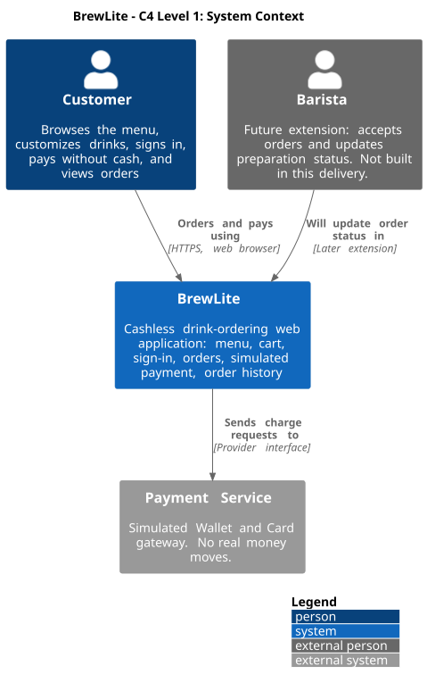
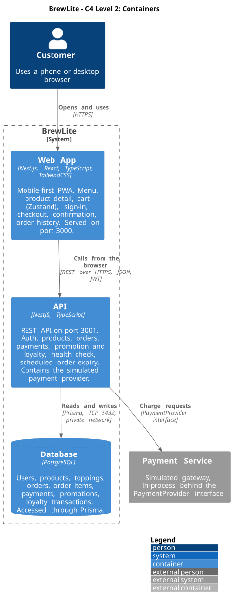
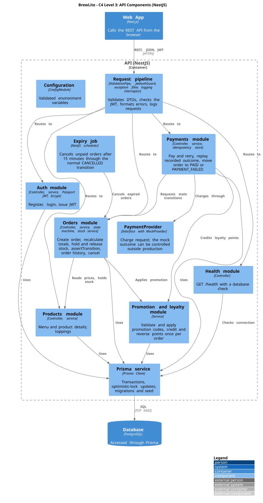

# BrewLite - Architecture Description

**Version:** 2.0  
**Status:** Draft for team review (task D-10); replaces the earlier flat `architecture.md`  
**Related:** [SRS](../requirements/srs.md), [UC-01 spec](../requirements/use-case-uc01-place-and-pay.md), [Decision log](../plans/decision-log.md), [Class diagram and data model](../diagrams/class-domain.md), [Sequence diagram](../diagrams/sequence-checkout.md), [Activity diagram](../diagrams/activity-checkout.md), [Deployment guide](../deployment.md), [ADRs](adr/)

This document describes how BrewLite is built (Assignment 2, Task 3.1). It uses the C4 model for the views and a layered structure inside the backend. The production deployment diagram is a separate task (`D-12`). Items marked **(proposed)** are team suggestions to confirm; items marked **(verify)** depend on facts that can go stale and must be checked before they are accepted.

## 1. Goals, drivers, and constraints

### 1.1 Architectural goals

- Deliver the customer flow from menu to paid order with the required stack.
- Keep rules for orders, payments, and stock in one place, the backend, so the UI cannot bypass them.
- Make payment retries safe and stock correct under concurrent orders.
- Run the whole system locally with one command, and deploy the same images to production.
- Keep the design small enough for a team of five to build, test, and explain.

### 1.2 Quality drivers

| Driver                        | Source           | What it means for the design                                                      |
| ----------------------------- | ---------------- | --------------------------------------------------------------------------------- |
| Correctness under concurrency | FR-11            | Database transactions with optimistic locking on stock                            |
| Safe retries                  | FR-10            | Unique idempotency key in the database and replay of the recorded result          |
| Valid order flow              | FR-09            | One state machine, used by every code path that changes status                    |
| Security                      | NFR-02 to NFR-04 | bcrypt, JWT, validated input, owner-only access                                   |
| Performance                   | NFR-01           | p95 under 500 ms with sample data; indexes for the hot queries                    |
| Mobile and PWA                | NFR-08           | Mobile-first Next.js app with a web manifest                                      |
| Operability                   | NFR-09           | `GET /health`, structured logs, validated configuration                           |
| Deployability                 | NFR-06, NFR-11   | Docker images, Compose locally, HTTPS in production, no secrets in the repository |
| Testability                   | NFR-13           | Real PostgreSQL in integration tests; domain logic separate from controllers      |

### 1.3 Constraints

Next.js for the frontend, NestJS for the backend, and PostgreSQL for the database are fixed by the assignments (constraint K1 in [context-and-scope.md](../requirements/context-and-scope.md#5-constraints)). Docker Compose must run the stack locally (K2). Payment is simulated (assumption A1 in [context-and-scope.md](../requirements/context-and-scope.md#4-assumptions)).

## 2. Architectural approach

**Views:** C4 levels 1 to 3 (context, containers, API components), drawn in PlantUML with exported SVG, plus the deployment view in `D-12`.

**Style:** a **modular monolith**. The backend is one NestJS application divided into domain modules (auth, products, orders, payments, promotion and loyalty). Each module has controllers (HTTP), services (use cases and domain rules), and data access through one Prisma service. The frontend is one Next.js application.

**Why this style**

- One deployable API means one transaction scope for the order, stock, and payment changes that must commit together.
- Modules keep boundaries clear, so the team can work in parallel without stepping on each other.
- Operating one API and one database is far cheaper than running several services.

**Alternatives considered**

| Alternative                                                 | Why not                                                                                                                           |
| ----------------------------------------------------------- | --------------------------------------------------------------------------------------------------------------------------------- |
| Microservices (separate order, payment, inventory services) | Distributed transactions would complicate the stock and idempotency rules; operating cost is far higher than this scope justifies |
| Serverless functions per endpoint                           | Cold starts conflict with the 500 ms target; transactions and connection pooling are harder                                       |
| Next.js route handlers as the backend                       | The assignment requires a NestJS backend                                                                                          |
| Unstructured single layer                                   | Business rules would leak into controllers and become hard to test                                                                |

## 3. C4 Level 1: system context



Source: [c4-context.puml](../diagrams/c4-context.puml).

The customer uses BrewLite through a web browser. The payment service is external and simulated. The barista is a future actor and is not built in this delivery.

## 4. C4 Level 2: containers



Source: [c4-container.puml](../diagrams/c4-container.puml).

| Container | Technology                              | Responsibility                                                                                         | Code                                       |
| --------- | --------------------------------------- | ------------------------------------------------------------------------------------------------------ | ------------------------------------------ |
| Web App   | Next.js, React, TypeScript, TailwindCSS | UI, cart state, sign-in state, calls the API from the browser; mobile-first PWA                        | `apps/web`                                 |
| API       | NestJS, TypeScript                      | All business rules and the REST interface; contains the simulated payment provider and the expiry job  | `apps/api`                                 |
| Database  | PostgreSQL                              | Persistent data; constraints enforce idempotency, non-negative stock, and one loyalty credit per order | Prisma schema and migrations in `apps/api` |

**Ports and calls:** the web app is served on port 3000 and the API on port 3001. The browser calls the API directly, so the API enables CORS for the configured frontend origin only. The database accepts connections only from the API over the private network.

**Where the mock payment service lives:** it is a module inside the API process behind the `PaymentProvider` interface, not a separate container. The context diagram shows it as an external system because it stands in for one.

## 5. C4 Level 3: API components



Source: [c4-component-api.puml](../diagrams/c4-component-api.puml).

| Component             | Responsibility                                                                           | Owns data                                | Depends on                                             | Endpoints                                                                      |
| --------------------- | ---------------------------------------------------------------------------------------- | ---------------------------------------- | ------------------------------------------------------ | ------------------------------------------------------------------------------ |
| Request pipeline      | Validates DTOs (whitelist), checks the JWT, formats errors, logs requests                | none                                     | none                                                   | all                                                                            |
| Auth                  | Register, login, bcrypt hashing, JWT issue                                               | `User`                                   | Prisma                                                 | `POST /auth/register`, `POST /auth/login`                                      |
| Products              | Menu, product details, toppings                                                          | `Product`, `Topping`                     | Prisma                                                 | `GET /products`, `GET /products/:id`                                           |
| Orders                | Create order, recalculate totals, hold and release stock, state machine, history, cancel | `Order`, `OrderItem`, `OrderItemTopping` | Products (stock), Promotion and loyalty, Prisma        | `POST /orders`, `GET /orders/me`, `GET /orders/:id`, internal status operation |
| Payments              | Pay and retry, idempotency, record attempts, request status changes                      | `Payment`                                | Orders, PaymentProvider, Promotion and loyalty, Prisma | `POST /payments`                                                               |
| PaymentProvider       | Interface for a charge; `MockProvider` is the default                                    | none                                     | none                                                   | none                                                                           |
| Promotion and loyalty | Validate and apply codes, credit and reverse points                                      | `Promotion`, `LoyaltyTransaction`        | Prisma                                                 | none (used by Orders and Payments)                                             |
| Expiry job            | Cancels `PENDING` and `PAYMENT_FAILED` orders after 15 minutes                           | none                                     | Orders                                                 | none                                                                           |
| Health                | Liveness and database check                                                              | none                                     | Prisma                                                 | `GET /health`                                                                  |
| Prisma service        | Transactions, optimistic-lock updates, connection                                        | all tables                               | PostgreSQL                                             | none                                                                           |
| Configuration         | Reads and validates environment variables                                                | none                                     | none                                                   | none                                                                           |

### 5.1 Layering rules inside the API

1. **Controller** handles HTTP: DTO in, response out, no business logic.
2. **Service** holds the use cases and domain rules (state machine, price calculation, stock, idempotency).
3. **Data access** goes only through the Prisma service; services never build SQL.
4. A module may call another module's **service**, never its repository or Prisma tables directly.
5. Only the Orders module changes order status, and it does so through `assertTransition`; the Payments module and the expiry job ask Orders to change state.
6. A controller never trusts client-sent prices, totals, user IDs, or payment outcomes. Identity comes from the JWT.

## 6. Key design mechanisms

### 6.1 Order state machine

Allowed transitions are in the [SRS](../requirements/srs.md#5-order-state-machine). A single transition map and `assertTransition(current, next)` reject everything else, and the update is conditional on the current status so two concurrent requests cannot both move the same order. `CANCELLED` is reachable only from `PENDING`, `PAYMENT_FAILED`, and `PAID`.

### 6.2 Stock holding with optimistic locking

Creating an order runs in one Prisma interactive transaction (`$transaction`). For each item the stock update is conditional on the version and on enough stock, as in this design sketch:

```ts
const result = await tx.product.updateMany({
  where: { id: productId, version, stock: { gte: qty } },
  data: { stock: { decrement: qty }, version: { increment: 1 } },
});
if (result.count === 0) { /* re-read and retry a limited number of times, else insufficient stock */ }
```

A count of zero means another order changed the row or stock is insufficient; the service retries a few times (for example three) and then returns a conflict. The order sets `stockHeld = true`. Releasing stock happens in the same transaction as the move to `CANCELLED` and sets `stockHeld = false`, so a repeated cancel cannot release twice. The database also checks `stock >= 0`.

### 6.3 Idempotent payment

1. The UI sends a new `Idempotency-Key` per attempt.
2. The API looks up the payment by (user, key). If found, it returns the recorded outcome.
3. If not found, it calls the provider, then records the payment and changes the order status in one transaction.
4. If two requests with the same key arrive at the same moment, the database unique constraint on (user, key) rejects the second insert and the API returns the recorded outcome.

The charge call happens outside the database transaction. If the commit fails after a successful charge, the order stays `PENDING` and the recorded attempt supports a safe retry. This is acceptable for a mock; a real provider would need a stricter recovery rule.

### 6.4 Payment provider

`PaymentProvider` is an interface with one operation (charge an amount with a method and return an outcome). `MockProvider` is the default. The QR demo (`C-21`) and a sandbox adapter (`C-22`) are optional implementations of the same interface. The provider only reports an outcome; idempotency, state changes, and loyalty crediting stay outside it. The outcome control used for demos (for example `PAYMENT_MOCK_CONTROL`) is off by default in production (decision 4).

### 6.5 Promotion and loyalty

The server validates the code (active, within dates, minimum total, usage limit), applies it once per order, and never discounts below zero. Points are `floor(paidTotal / 1000)`, credited after `PAID` as an `EARN` row. A unique (order, type) constraint allows at most one credit and one reversal per order. A paid order that is cancelled gets a negative `REVERSAL` row.

### 6.6 Order expiry

A scheduled job (the NestJS scheduler) runs about once a minute and cancels `PENDING` and `PAYMENT_FAILED` orders whose `expiresAt` has passed, through the normal `CANCELLED` transition. Because the transition and the `stockHeld` flag make cancel and release safe to repeat, running the job twice (for example on two API instances) does no harm.

## 7. Frontend architecture

| Concern    | Approach                                                                                                                                           |
| ---------- | -------------------------------------------------------------------------------------------------------------------------------------------------- |
| Framework  | Next.js (App Router), React, TypeScript, TailwindCSS                                                                                               |
| Screens    | Menu, product detail, cart, sign-in and register, checkout, confirmation, order history                                                            |
| Cart state | Zustand with `persist` (localStorage), so the cart survives sign-in redirects and reloads (decision 2). The cart is cleared after a `PAID` result. |
| API access | One typed client module that attaches the JWT, sets the `Idempotency-Key`, and maps errors                                                         |
| Auth state | JWT held by the client; protected screens redirect to sign-in and keep the cart. The storage choice is discussed in sections 11 and 14.            |
| UI states  | Every data fetch handles loading, empty, and error states (NFR-07)                                                                                 |
| PWA        | Web manifest and icons; add a minimal service worker if the target browsers need one for installability **(verify)**                               |
| Money      | Integers in VND; formatted with thousands separators in the UI; the displayed total is informational, the server total is authoritative            |

Check the Next.js caching settings: authenticated API calls and user-specific pages must never be served from a shared cache to another user. Keep those calls on the client or mark them dynamic **(verify with the Next.js version in use)**.

## 8. Data architecture

- **Database:** PostgreSQL, accessed through Prisma (decision 1). The domain model and constraints are in [class-domain.md](../diagrams/class-domain.md).
- **Migrations:** Prisma Migrate. Local development uses `prisma migrate dev`; CI and production use `prisma migrate deploy`, run as an explicit step before the new API version starts. The `db:migrate` script wraps these commands.
- **Seed:** a seed script loads about 30 products, toppings, a few users, and the promotions `BREW10` and `WELCOME20K`. The `db:seed` script runs it. Migrations plus seed rebuild the database from scratch (NFR-12).
- **Money:** whole VND as integers; no floating-point math (decision 5).
- **Constraints:** unique (user, idempotency key), unique (order, loyalty type), non-negative stock, and positive quantities; indexes for order history by user and for the expiry job.

## 9. Cross-cutting concerns

### 9.1 Security

- Passwords hashed with bcrypt (cost 10); the hash is never returned.
- JWT signed with a secret from the environment; the user ID comes from the token, never from the request body. Token lifetime of about one hour is proposed **(proposed)**.
- DTO validation with whitelisting rejects unknown fields.
- Every order and payment read or write is limited to the owner.
- CORS allows only the configured frontend origin.
- Secrets live in environment variables and the CI secret store; `.env` is never committed.

### 9.2 Logging

- Use the NestJS logger with one structured (JSON) line per request: method, path, status, duration, and a request ID **(proposed)**.
- Log state transitions, payment outcomes, stock conflicts, and expiry runs at info level; errors with a stack trace at error level.
- Never log passwords, JWTs, secrets, or full payment details.
- In Docker and on the hosting platform, logs go to standard output so the platform collects them.

### 9.3 Health check

`GET /health` returns 200 when the API is up and the database answers a trivial query, and 503 otherwise. Docker Compose uses it for the container health check, the hosting platform uses it as its health check path, and the CD pipeline calls it as the smoke test after deployment.

### 9.4 Configuration

- Backend: environment variables read through the NestJS configuration module and validated at startup; the application refuses to start if a required value is missing or invalid.
- Variables are listed in `.env.example`: database settings, `DATABASE_URL`, `API_PORT`, `JWT_SECRET`, `CORS_ORIGIN`, `NEXT_PUBLIC_API_URL`, and the payment settings.
- Next.js inlines `NEXT_PUBLIC_*` values **at build time**. The web image therefore needs the correct API URL when it is built, once per environment (local, production). The CD pipeline must pass it as a build argument **(verify)**.

### 9.5 Error handling

A global exception filter returns a consistent JSON error with a status code, a short message, and field details for validation errors. Status codes follow the proposals in the [UC-01 spec](../requirements/use-case-uc01-place-and-pay.md#9-api-calls-used).

## 10. Deployment overview

The full production diagram and runbook are in `D-12` and `D-15`; this is the architectural summary.

| Environment | Setup                                                                                                                                                                                                                                          |
| ----------- | ---------------------------------------------------------------------------------------------------------------------------------------------------------------------------------------------------------------------------------------------- |
| Local       | Docker Compose runs `web`, `api`, and `db` with health checks and a named volume; see [deployment.md](../deployment.md)                                                                                                                        |
| CI          | GitHub Actions on pull requests: install, lint, unit test, build; integration tests against a PostgreSQL service container                                                                                                                     |
| Production  | Render running the Docker images for the web app and the API with a private managed PostgreSQL database; HTTPS and health checks provided by the platform. A small VPS with Docker Compose and Caddy is the fallback (decision 3) **(verify)** |

Images are tagged with the commit SHA, pushed to a registry if the platform needs one, deployed with CI secrets, then smoke-tested through `GET /health`. A failed deploy stops the pipeline and the previous image is redeployed as the rollback.

**Points to check before accepting Render:** free-tier sleep or database limits against the 500 ms target and the "URL live at grading" rule, and that the database is not publicly reachable on the chosen plan (risk R8).

## 11. Trade-offs and limitations

| Choice                                | Benefit                                                 | Cost or limit                                                                                                 |
| ------------------------------------- | ------------------------------------------------------- | ------------------------------------------------------------------------------------------------------------- |
| Modular monolith                      | One transaction scope, simple operation                 | One failure domain; modules can become coupled without discipline                                             |
| Prisma                                | Built-in migrations, typed queries, simple transactions | Less flexible than raw SQL for unusual queries                                                                |
| Optimistic locking on stock           | No long locks; scales for the demo                      | Conflicts need bounded retries; heavy contention could return conflicts                                       |
| Zustand with `persist`                | Cart survives reloads and sign-in                       | The cart lives in browser storage; clear it on payment                                                        |
| JWT in browser storage **(proposed)** | Simple with a separate API origin                       | Readable by injected scripts (XSS); an HttpOnly cookie is safer but needs CSRF handling and credentialed CORS |
| Charge outside the transaction        | Provider call does not hold database locks              | Needs the recorded attempt and idempotency key to recover                                                     |
| Mock payment provider                 | Meets the assignment, fully testable                    | Does not exercise real provider behavior such as callbacks                                                    |
| In-process expiry job                 | No extra service                                        | Runs on every instance; safe only because cancel is repeatable                                                |
| Single database                       | Simple                                                  | No read scaling; sufficient for the demo                                                                      |
| No cache                              | Fewer moving parts                                      | Every menu request hits the database; fine at sample scale                                                    |

## 12. Architecture decision records

ADR files are in [`docs/architecture/adr/`](adr/README.md) (written in `D-11`). They record the decisions in the [decision log](../plans/decision-log.md).

| ADR                                                                    | Topic                                                                      | Decision log               | Status                             |
| ---------------------------------------------------------------------- | -------------------------------------------------------------------------- | -------------------------- | ---------------------------------- |
| [`001-monorepo.md`](adr/001-monorepo.md)                               | Single repository with `apps/web` and `apps/api`                           | Fixed by Assignment 2      | Accepted                           |
| [`002-orm-prisma.md`](adr/002-orm-prisma.md)                           | Prisma as the ORM                                                          | Decision 1                 | Accepted                           |
| [`003-cart-state-zustand.md`](adr/003-cart-state-zustand.md)           | Zustand with persist                                                       | Decision 2                 | Accepted                           |
| [`004-hosting-platform.md`](adr/004-hosting-platform.md)               | Render, with a VPS fallback                                                | Decision 3                 | Proposed (verify)                  |
| [`005-payment-mock-provider.md`](adr/005-payment-mock-provider.md)     | Mock provider behind `PaymentProvider`                                     | Decision 4                 | Accepted                           |
| [`006-money-and-pricing.md`](adr/006-money-and-pricing.md)             | VND integers and surcharges                                                | Decisions 5 and 6          | Accepted                           |
| [`007-stock-unit.md`](adr/007-stock-unit.md)                           | Finished drinks per product                                                | Decision 7                 | Accepted                           |
| [`008-cancellation-and-expiry.md`](adr/008-cancellation-and-expiry.md) | Owner cancel, simulated refund, 15-minute expiry                           | Decision 8                 | Accepted                           |
| [`009-promotion-loyalty.md`](adr/009-promotion-loyalty.md)             | Promotion types and loyalty points                                         | Decision 9                 | Accepted                           |
| [`010-diagram-format.md`](adr/010-diagram-format.md)                   | PlantUML with exported SVG                                                 | Decision 10                | Accepted (confirm with instructor) |
| [`011-test-tooling.md`](adr/011-test-tooling.md)                       | Test tools, performance method, browser baseline                           | Decisions 11 to 13         | Superseded by 015 (runner); rest Accepted (browser list to verify) |
| [`012-architecture-style.md`](adr/012-architecture-style.md)           | Modular monolith (section 2)                                               | New **(proposed)**         | Proposed                           |
| [`013-auth-token-handling.md`](adr/013-auth-token-handling.md)         | JWT lifetime and storage (sections 9.1 and 11)                             | New **(proposed)**         | Proposed                           |
| [`014-logging-and-config.md`](adr/014-logging-and-config.md)           | Structured logging and build-time web configuration (sections 9.2 and 9.4) | New **(proposed)**         | Proposed                           |
| [`015-test-runner-vitest.md`](adr/015-test-runner-vitest.md)           | Vitest as the API test runner                                              | Decision 14                | Accepted                           |

## 13. Traceability from architecture to code

Each container and component maps to code, so the deployment diagram (`D-12`) can trace every node.

| Architecture element              | Code location (target)    | Requirements                                  |
| --------------------------------- | ------------------------- | --------------------------------------------- |
| Web App                           | `apps/web`                | FR-01 to FR-03, FR-07, NFR-07, NFR-08, NFR-14 |
| API                               | `apps/api`                | all backend requirements                      |
| Auth module                       | `apps/api/src/auth`       | FR-04, NFR-02, NFR-03                         |
| Products module                   | `apps/api/src/products`   | FR-01, FR-02                                  |
| Orders module                     | `apps/api/src/orders`     | FR-05, FR-08, FR-09, FR-11, FR-13 to FR-16    |
| Payments module and provider      | `apps/api/src/payments`   | FR-06, FR-10, FR-17, FR-18                    |
| Promotion and loyalty module      | `apps/api/src/promotions` | FR-12                                         |
| Expiry job                        | `apps/api/src/orders`     | FR-16                                         |
| Health module                     | `apps/api/src/health`     | NFR-09                                        |
| Database schema, migrations, seed | `apps/api/prisma`         | NFR-12                                        |
| Docker Compose                    | `docker-compose.yml`      | NFR-06                                        |
| CI and CD                         | `.github/workflows`       | NFR-10, NFR-11                                |

The detailed code structure inside each app is a separate, later document.

## 14. Points to confirm

1. **Architecture style:** is a modular monolith acceptable to the team and the instructor (proposed ADR 012)?
2. **JWT storage:** browser storage or an HttpOnly cookie (proposed ADR 013)? The first is simpler; the second is safer.
3. **Logging library:** the built-in NestJS logger with JSON lines, or a dedicated library such as `nestjs-pino` (proposed ADR 014)?
4. **Web build-time API URL:** one web image per environment, or a runtime configuration approach?
5. **PWA scope:** manifest only, or also a service worker for installability?
6. **Expiry timing:** does the 15-minute window start at order creation or restart on a retry? (Also in the class diagram points.)
7. **Hosting:** confirm Render plan limits before accepting decision 3.
8. **Update the other documents:** `deployment.md` should drop the generic ORM wording, and the SRS entity list should match the class diagram.

## 15. Review checklist (for D-13)

- [ ] The three C4 diagrams match the sections above and the [sequence diagram](../diagrams/sequence-checkout.md).
- [ ] Every module in section 5 maps to code in section 13 and to a requirement.
- [ ] The order state machine, stock rule, and idempotency rule match the SRS and the [class diagram](../diagrams/class-domain.md).
- [ ] Decisions in section 12 match the [decision log](../plans/decision-log.md).
- [ ] Logging, health check, configuration, and migrations are described (Assignment 2, Task 3.1).
- [ ] Reasons, advantages, limits, and trade-offs are stated (Assignment 2, Task 3.1).
- [ ] The rendered SVG files match the `.puml` sources.

## 16. Export the diagrams

The SVG files are committed next to the sources. After changing a `.puml` file, re-export and commit both together. You need Java and Graphviz installed. The C4 diagrams use the C4 library bundled with PlantUML.

```powershell
java -jar plantuml.jar -tsvg docs/diagrams/c4-context.puml docs/diagrams/c4-container.puml docs/diagrams/c4-component-api.puml
```