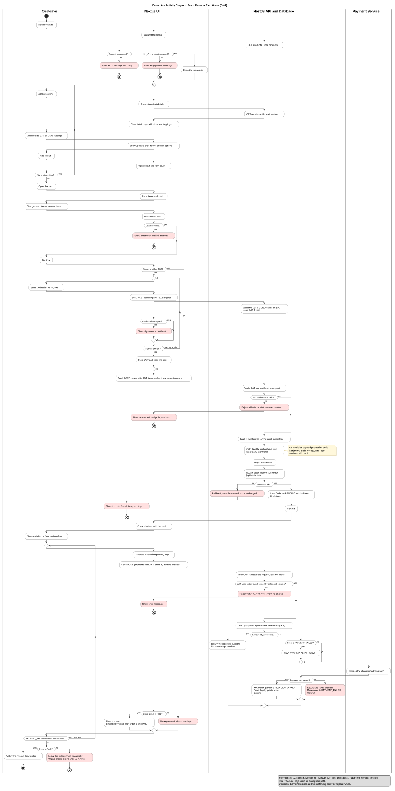

# BrewLite - Activity Diagram: From Menu to Paid Order

**Version:** 0.1  
**Status:** Draft for team review (task D-07)  
**Source file:** [activity-checkout.puml](activity-checkout.puml) (PlantUML, source of truth)  
**Rendered file:** [activity-checkout.svg](activity-checkout.svg)  
**Related:** [UC-01 spec](../requirements/use-case-uc01-place-and-pay.md), [SRS](../requirements/srs.md), [Sequence diagram](sequence-checkout.md), [Class diagram](class-domain.md), [Decision log](../plans/decision-log.md)

This is the activity diagram for the main end-to-end flow (Assignment 2, Task 2.1): from opening the app, through choosing and customizing drinks, the cart, sign-in, order creation, and payment, to collecting the drink. It uses four swimlanes. Items marked **(proposed)** are team suggestions to confirm.

## 1. Diagram



The diagram is tall, so open the SVG directly to read it at full size.

## 2. Swimlanes

| Lane | Who or what | Examples of actions |
|---|---|---|
| Customer | The person using the app | Choose a drink, choose size and toppings, tap Pay, choose Wallet or Card |
| Next.js UI | The browser app | Show menu, update cart, store the JWT, send API requests, show results |
| NestJS API and Database | The backend and its PostgreSQL database, shown together | Validate, calculate the total, update stock, save the order and payment |
| Payment Service | The mock gateway | Process the charge |

The [sequence diagram](sequence-checkout.md) shows the API and the database as separate lifelines. The activity diagram combines them to keep the lanes readable.

## 3. Coverage of Assignment 2, Task 2.1

| Required | Where it appears |
|---|---|
| Start and end points | One start node; end nodes for each failure or abandoned path and a final node after collecting the drink |
| User and system actions | The Customer lane versus the other three lanes |
| Decisions and merges for success and failure | Diamonds for request result, empty menu, empty cart, signed in, valid request, enough stock, payable order, known idempotency key, payment result, order status, retry |
| Swimlanes | Four lanes (section 2) |
| Out of stock | `Enough stock?` branch, with rollback and a message naming the item |
| Not signed in | `Signed in with a JWT?` branch with the sign-in loop |
| Payment failed | `Payment succeeded?` branch, then the retry loop |

## 4. Mapping to UC-01 and requirements

| Diagram part | UC-01 reference | Requirements |
|---|---|---|
| Menu request, error and empty states | Before the main flow (UC-02) | FR-01, NFR-07 |
| Product detail, size, toppings, price update, add to cart | UC-03 and UC-04 | FR-02, FR-03 |
| Cart editing and empty cart | UC-04 | FR-03 |
| Sign-in loop | Alternate flow A1, exception E4 | FR-04, NFR-03 |
| Order creation, JWT and validation | Main steps 3 and 4, exceptions E2 and E4 | FR-05, NFR-03, NFR-04 |
| Promotion note | Alternate flow A3 | FR-12 |
| Stock transaction and out of stock | Main step 5, exceptions E1 and E7 | FR-11 |
| Payment request and rejection | Main steps 8 and 9, exceptions E5 and E6 | FR-06, FR-09 |
| Known idempotency key | Alternate flow A5 | FR-10 |
| Retry from `PAYMENT_FAILED` | Alternate flow A4 | FR-06 |
| Payment success: loyalty points, confirmation | Main steps 10 to 13 | FR-06, FR-07, FR-12 |
| Payment failure, cart kept | Exception E3 | FR-06 |
| Unpaid order left or cancelled, 15-minute expiry | Alternate flow A6 | FR-15, FR-16 |

## 5. Reading notes

- A red action is a failure, rejection, or exception path.
- Merge points are the places where branches join again after `endif` or `repeat while`; PlantUML draws them as small diamonds.
- The two loops are the "Add another drink?" loop and the payment retry loop. The sign-in loop covers both login and registration.
- The payment retry always generates a **new** `Idempotency-Key`, as in the UC-01 spec. A request that reuses an already processed key returns the recorded outcome without a new charge.

## 6. Design points to confirm

1. **Failure paths end the flow.** Empty cart, bad request, out of stock, and payment rejection each end with a message. After an out-of-stock message the customer changes the cart and taps Pay again; this return is not drawn, to keep the diagram readable.
2. **An abandoned `PENDING` order keeps its stock held** until it is paid, cancelled, or expires after 15 minutes (decision 8). The customer-facing cancel screen (UC-08) is Could and is only mentioned in the last action.
3. **Loading states are not drawn.** The menu "loading" state from FR-01 is a UI detail; the diagram shows only the outcomes (error, empty, loaded).
4. **The promotion is a note, not a branch.** The rule (invalid code rejected, customer may continue without it) is in the UC-01 spec and the `T-08` tests.
5. **Status codes are proposals** (401, 400, 403, 404, 409) and match the [sequence diagram](sequence-checkout.md).
6. **Format.** This diagram follows the PlantUML decision. The use-case overview and the sequence diagram are still Mermaid and need converting to match.

## 7. Export the rendered image

The SVG is committed next to the source. After changing `activity-checkout.puml`, re-export it and commit both files together. You need Java and Graphviz installed.

```powershell
java -jar plantuml.jar -tsvg docs/diagrams/activity-checkout.puml
```

To export a PNG, raise the size limit, because the default stops at 4096 pixels and this diagram is taller:

```powershell
java -DPLANTUML_LIMIT_SIZE=16384 -jar plantuml.jar -tpng docs/diagrams/activity-checkout.puml
```

## 8. Review checklist (for D-13)

- [ ] The flow matches the UC-01 main, alternate, and exception flows.
- [ ] Every failure path named in Assignment 2 (out of stock, not signed in, payment failed) is drawn.
- [ ] Order states mentioned (`PENDING`, `PAID`, `PAYMENT_FAILED`) match the [state machine in the SRS](../requirements/srs.md#5-order-state-machine).
- [ ] API paths and status codes match the [sequence diagram](sequence-checkout.md) and the [API baseline](../requirements/srs.md#7-api-baseline).
- [ ] Lane names match the lifelines used in the sequence diagram.
- [ ] The rendered SVG matches the `.puml` source.
