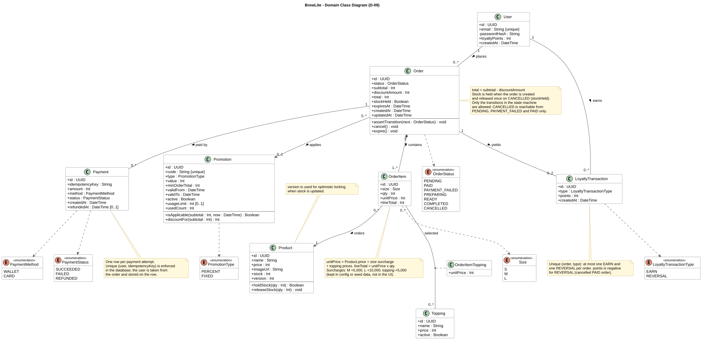

# BrewLite - Domain Class Diagram and Data Model

**Version:** 0.1  
**Status:** Draft for team review (task D-09)  
**Source file:** [class-domain.puml](class-domain.puml) (PlantUML, source of truth)  
**Rendered file:** [class-domain.svg](class-domain.svg)  
**Related:** [SRS](../requirements/srs.md), [UC-01 spec](../requirements/use-case-uc01-place-and-pay.md), [Sequence diagram](sequence-checkout.md), [Decision log](../plans/decision-log.md), [Implementation plan](../plans/03-implementation-plan.md)

This is the domain-level class diagram required by Assignment 2, Task 2.3, plus the database constraints that follow from it. It applies the decisions in the [decision log](../plans/decision-log.md) (Prisma, whole-VND integers, pricing surcharges, finished-drink stock, cancellation and expiry, promotion and loyalty rules). Items marked **(proposed)** are team suggestions to confirm.

## 1. Diagram



Reading notes:

- Money is a whole-VND `Int`; there are no decimals.
- Foreign keys are drawn as associations, not as attributes. The data model in section 5 lists the columns.
- Methods show where domain rules live (stock holding, state transitions, promotion math). Their signatures are design intent, not final code.

## 2. Classes

| Class                | Purpose                                             | Notes                                                                                                                                                         |
| -------------------- | --------------------------------------------------- | ------------------------------------------------------------------------------------------------------------------------------------------------------------- |
| `User`               | A registered customer                               | `email` is unique and stored in lower case. Only `passwordHash` (bcrypt) is stored. `loyaltyPoints` is the running balance.                                   |
| `Product`            | A drink on the menu                                 | `price` is the price for size S. `stock` counts finished drinks. `version` supports optimistic locking on stock updates.                                      |
| `Topping`            | An available topping                                | One seed table with a price (+5,000 each); `active` hides a topping without deleting it.                                                                      |
| `Order`              | A customer's order                                  | Holds `status`, `subtotal`, `discountAmount`, `total = subtotal - discountAmount`, `stockHeld`, and `expiresAt` (15-minute expiry for unpaid orders).         |
| `OrderItem`          | One line of an order                                | Stores `size`, `qty`, a snapshot `unitPrice` (base plus size surcharge plus toppings), and `lineTotal = unitPrice x qty`.                                     |
| `OrderItemTopping`   | Association class between `OrderItem` and `Topping` | Keeps a price snapshot so later price changes do not alter past orders.                                                                                       |
| `Payment`            | One payment attempt for an order                    | A failed attempt and a later successful retry are separate rows. `status` is `SUCCEEDED`, `FAILED`, or `REFUNDED`; `refundedAt` records the simulated refund. |
| `Promotion`          | A discount code                                     | `PERCENT` or `FIXED`, minimum order total, validity period, optional usage limit. Seeds: `BREW10`, `WELCOME20K`.                                              |
| `LoyaltyTransaction` | A change to a customer's points                     | `EARN` when an order is paid; `REVERSAL` (negative points) when a paid order is cancelled.                                                                    |

## 3. Enumerations

| Enum                     | Values                                                                              |
| ------------------------ | ----------------------------------------------------------------------------------- |
| `OrderStatus`            | `PENDING`, `PAID`, `PAYMENT_FAILED`, `PREPARING`, `READY`, `COMPLETED`, `CANCELLED` |
| `Size`                   | `S`, `M`, `L`                                                                       |
| `PaymentMethod`          | `WALLET`, `CARD`                                                                    |
| `PaymentStatus`          | `SUCCEEDED`, `FAILED`, `REFUNDED`                                                   |
| `PromotionType`          | `PERCENT`, `FIXED`                                                                  |
| `LoyaltyTransactionType` | `EARN`, `REVERSAL`                                                                  |

Allowed `OrderStatus` transitions are in the [state machine in the SRS](../requirements/srs.md#5-order-state-machine). `CANCELLED` is reachable only from `PENDING`, `PAYMENT_FAILED`, and `PAID`.

## 4. Relationships and multiplicity

| From        | To                   | Multiplicity | Meaning                                                                    |
| ----------- | -------------------- | ------------ | -------------------------------------------------------------------------- |
| `User`      | `Order`              | 1 to 0..*    | A user places many orders; each order has one user                         |
| `Order`     | `OrderItem`          | 1 to 1..*    | Composition: an order has at least one item; items do not exist without it |
| `OrderItem` | `Product`            | 0..* to 1    | Each item is for one product                                               |
| `OrderItem` | `Topping`            | 0..* to 0..* | An item can have several toppings; resolved by `OrderItemTopping`          |
| `Order`     | `Payment`            | 1 to 0..*    | An order can have several attempts                                         |
| `Order`     | `Promotion`          | 0..* to 0..1 | At most one code per order                                                 |
| `User`      | `LoyaltyTransaction` | 1 to 0..*    | A user's points history                                                    |
| `Order`     | `LoyaltyTransaction` | 1 to 0..2    | At most one `EARN` and one `REVERSAL` per order                            |

## 5. Data model and database constraints

Names follow the class names; the exact table and column naming is set when the Prisma schema is written (`C-03`).

| Table                | Columns                                                                                                                                       | Constraints and indexes                                                                                                                                                                            |
| -------------------- | --------------------------------------------------------------------------------------------------------------------------------------------- | -------------------------------------------------------------------------------------------------------------------------------------------------------------------------------------------------- |
| `User`               | `id`, `email`, `passwordHash`, `loyaltyPoints`, `createdAt`                                                                                   | Unique `email`                                                                                                                                                                                     |
| `Product`            | `id`, `name`, `price`, `imageUrl`, `stock`, `version`                                                                                         | Check `stock >= 0` and `price >= 0`; `version` increments on each stock update                                                                                                                     |
| `Topping`            | `id`, `name`, `price`, `active`                                                                                                               | Check `price >= 0`                                                                                                                                                                                 |
| `Order`              | `id`, `userId`, `status`, `subtotal`, `discountAmount`, `total`, `promotionId` (nullable), `stockHeld`, `expiresAt`, `createdAt`, `updatedAt` | FK to `User` and `Promotion`; check `total >= 0` and `discountAmount <= subtotal`; index (`userId`, `createdAt` descending) for `GET /orders/me`; index (`status`, `expiresAt`) for the expiry job |
| `OrderItem`          | `id`, `orderId`, `productId`, `size`, `qty`, `unitPrice`, `lineTotal`                                                                         | FK to `Order` and `Product`; check `qty > 0`                                                                                                                                                       |
| `OrderItemTopping`   | `orderItemId`, `toppingId`, `unitPrice`                                                                                                       | Composite primary key (`orderItemId`, `toppingId`)                                                                                                                                                 |
| `Payment`            | `id`, `orderId`, `userId`, `idempotencyKey`, `amount`, `method`, `status`, `createdAt`, `refundedAt`                                          | FK to `Order` and `User`; **unique (`userId`, `idempotencyKey`)**; index on `orderId`                                                                                                              |
| `Promotion`          | `id`, `code`, `type`, `value`, `minOrderTotal`, `validFrom`, `validTo`, `active`, `usageLimit`, `usedCount`                                   | Unique `code`; check `value > 0`; for `PERCENT`, check `value <= 100`                                                                                                                              |
| `LoyaltyTransaction` | `id`, `userId`, `orderId`, `type`, `points`, `createdAt`                                                                                      | FK to `User` and `Order`; **unique (`orderId`, `type`)**                                                                                                                                           |

`Payment.userId` repeats the order's user so the database can enforce the idempotency uniqueness directly. This is the constraint that stops two simultaneous requests with the same key from both succeeding (see the note in the [sequence diagram](sequence-checkout.md)).

## 5.1 How stock and expiry use the model

- **Hold:** creating an order sets `stockHeld = true` and decreases `Product.stock` with a version check, in one transaction.
- **Release:** moving an order to `CANCELLED` (by the owner or by expiry) increases `Product.stock` and sets `stockHeld = false` in the same transaction. The `stockHeld` flag makes a second release impossible.
- **Expiry:** a scheduled job cancels `PENDING` and `PAYMENT_FAILED` orders whose `expiresAt` has passed, through the normal `CANCELLED` transition.

## 6. Mapping to the SRS entities

| SRS minimum entity                                        | Model                         | Differences                                                                                   |
| --------------------------------------------------------- | ----------------------------- | --------------------------------------------------------------------------------------------- |
| `Product(id, name, price, imageUrl, stock)`               | `Product`                     | Adds `version`                                                                                |
| `User(id, email, passwordHash, loyaltyPoints)`            | `User`                        | Adds `createdAt`                                                                              |
| `Order(id, userId, status, total, createdAt)`             | `Order`                       | Adds `subtotal`, `discountAmount`, promotion reference, `stockHeld`, `expiresAt`, `updatedAt` |
| `OrderItem(id, orderId, productId, size, qty, lineTotal)` | `OrderItem`                   | Adds `unitPrice` and toppings through `OrderItemTopping`                                      |
| `Payment(id, orderId, idempotencyKey, amount, method)`    | `Payment`                     | Adds `userId`, `status`, `createdAt`, `refundedAt`                                            |
| `Promotion` (Assignment 2)                                | `Promotion`                   | Fields from the decision log                                                                  |
| `LoyaltyTransaction` (Assignment 2)                       | `LoyaltyTransaction`          | Adds `type` for the compensating row                                                          |
| none                                                      | `Topping`, `OrderItemTopping` | New, needed for FR-02                                                                         |

## 7. Mapping to requirements

| Requirement  | Classes                                                                                         |
| ------------ | ----------------------------------------------------------------------------------------------- |
| FR-01, FR-02 | `Product`, `Topping`, `Size`                                                                    |
| FR-03        | Cart is client state; it becomes `Order` and `OrderItem` at checkout                            |
| FR-04        | `User`                                                                                          |
| FR-05        | `Order`, `OrderItem`, `OrderItemTopping`, `Product`                                             |
| FR-06, FR-10 | `Payment`, `PaymentMethod`, `PaymentStatus`                                                     |
| FR-09        | `Order`, `OrderStatus`                                                                          |
| FR-11        | `Product.stock`, `Product.version`, `Order.stockHeld`                                           |
| FR-12        | `Promotion`, `LoyaltyTransaction`, `User.loyaltyPoints`                                         |
| FR-15, FR-16 | `Order.status`, `Order.expiresAt`, `Payment.status` (refund), `LoyaltyTransaction` (`REVERSAL`) |
| NFR-02       | `User.passwordHash`                                                                             |

## 8. Points to confirm

1. **Decision log conflict on loyalty uniqueness.** Decision 9 says a unique `orderId` on `LoyaltyTransaction` enforces one credit per order. Decision 8 also adds a compensating negative row for a cancelled paid order. Both rows carry the same `orderId`, so a unique `orderId` would block the reversal. This model uses unique (`orderId`, `type`) instead. Update the decision log to match, or decide another way to reverse points.
2. **Toppings are available for every product (proposed).** The seed table has no per-product list. If some drinks must not take toppings, add a `ProductTopping` link table.
3. **When does the 15-minute expiry start?** From `createdAt`, or restarted when the customer retries a failed payment? This model has `expiresAt`, so either works; choose before `C-09`.
4. **When is a promotion's `usedCount` increased?** At order creation, at `PAID`, and is it given back on cancel? Choose before `C-12`.
5. **Price snapshots (proposed).** `unitPrice` on `OrderItem` and `OrderItemTopping` freeze prices at order time. The server still recalculates from current data when the order is created.
6. **Payment amount.** `Payment.amount` equals `Order.total` at the moment of the attempt. A refund reuses that amount.
7. **Refund representation.** A `PAID` cancel sets the payment to `REFUNDED` with `refundedAt`. If the team prefers a separate refund row, change `Payment` accordingly.

## 9. Follow-up updates

- Update the entity list in [srs.md](../requirements/srs.md#62-entities) to match section 6 above.
- Update the persistence section of [architecture.md](../architecture/architecture.md) to name Prisma and the constraints above (`D-10`).
- `C-03` turns this model into the Prisma schema, migrations, and seed data (products, a few users, `BREW10`, `WELCOME20K`).

## 10. Export the rendered image

The SVG is committed next to the source. After changing `class-domain.puml`, re-export it and commit both files together. You need Java and Graphviz installed.

```powershell
java -jar plantuml.jar -tsvg docs/diagrams/class-domain.puml
```

You can also use the PlantUML extension in VS Code. Do not paste project files into public online renderers if they contain anything sensitive.

## 11. Review checklist (for D-13)

- [ ] Every minimum entity in the SRS and Assignment 1 is present.
- [ ] `Promotion` and `LoyaltyTransaction` are present, with the status enums, attributes, and multiplicity Assignment 2 asks for.
- [ ] `OrderStatus` matches the SRS state machine.
- [ ] Names used in the [sequence diagram](sequence-checkout.md) (Order, OrderItems, Payment, LoyaltyTransaction) match this model.
- [ ] Constraints in section 5 cover idempotency, non-negative stock, and one loyalty credit per order.
- [ ] The rendered SVG matches the `.puml` source.
