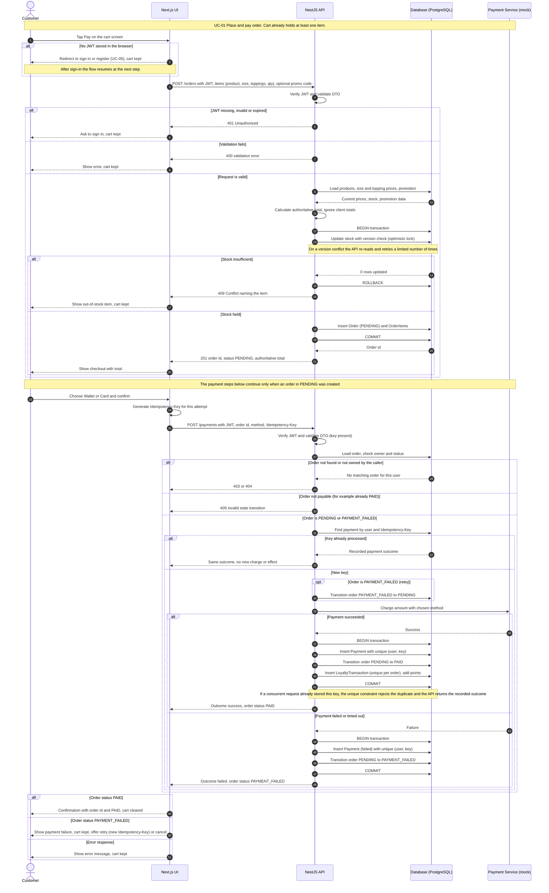

# BrewLite - Sequence Diagram: Checkout (UC-01)

**Version:** 0.1  
**Status:** Draft for team review (task D-08)  
**Source file:** [sequence-checkout.mmd](sequence-checkout.mmd) (the source of truth; this page embeds a copy)  
**Rendered file:** `sequence-checkout.svg` (to be exported, see section 5)  
**Related:** [UC-01 spec](../requirements/use-case-uc01-place-and-pay.md), [SRS](../requirements/srs.md), [Use-case overview](use-case-overview.md), [Architecture](../architecture/architecture.md)

This diagram covers the full checkout use case UC-01 (Assignment 2, Task 2.2): from tapping Pay, through order creation and payment, to the result shown to the customer. Items marked **(proposed)** are team suggestions to confirm.

## 1. Diagram



## 2. How the diagram maps to UC-01

| Diagram part | UC-01 steps and flows | Requirements |
|---|---|---|
| Sign-in check | Main step 2, alternate A1, exception E4 | FR-04, NFR-03 |
| Create order: JWT and DTO validation | Main steps 3 and 4, exceptions E2 and E4 | FR-05, NFR-03, NFR-04 |
| Create order: authoritative total | Main step 4 | FR-05 |
| Create order: stock transaction, optimistic lock, out of stock | Main step 5, exceptions E1 and E7 | FR-11 |
| Pay: Idempotency-Key and replay of a recorded outcome | Main steps 8 and 9, alternate A5 | FR-10 |
| Pay: ownership and state check | Exceptions E5 and E6 | FR-09, NFR-03 |
| Pay: retry from `PAYMENT_FAILED` | Alternate A4 | FR-06, FR-09 |
| Pay: success path, loyalty points | Main steps 10 to 12 | FR-06, FR-12 |
| Pay: failure or timeout path | Exceptions E3 and E8 | FR-06 |
| Result for the customer | Main step 13, exception E3 | FR-07 |

## 3. Coverage of Assignment 2, Task 2.2

| Required by the task | Where it appears |
|---|---|
| Lifelines Customer, Next.js UI, NestJS API, Database, Payment Service | The five participants at the top |
| Request/response and call order | Numbered messages, top to bottom |
| JWT check and data validation | "Verify JWT and validate DTO" in both the order and payment requests |
| Transaction when creating the order and updating stock | `BEGIN`, stock update with version check, `COMMIT` or `ROLLBACK` |
| `alt` for payment success and failure | The `alt Payment succeeded` / `Payment failed or timed out` block |
| Idempotency on a repeated payment request | The `alt Key already processed` block |
| Final result shown to the user | The last `alt` block |
| Out of stock, not signed in, payment failed (from the activity-diagram list) | `alt Stock insufficient`, `alt No JWT stored`, `Payment failed` branch |

## 4. Design points the team should confirm

1. **The charge happens outside the database transaction.** The API calls the payment service first and then records the result in one transaction. If the commit fails after a successful charge, the order stays `PENDING` and the recorded attempt and idempotency key support a safe retry (UC-01, E9). This is acceptable for a mock; a real provider would need a stricter recovery rule.
2. **Duplicate requests that arrive at the same moment.** Two requests with the same key can both pass the "not found" lookup. The unique constraint on user and key makes the second insert fail, and the API then returns the recorded outcome. The lookup alone is not enough.
3. **A retry after a failure uses a new Idempotency-Key (proposed).** The same key replays the recorded failure by design. The order moves `PAYMENT_FAILED` to `PENDING` as the first step of the retry.
4. **A timeout is treated as a failed payment (proposed).** This is fine for the mock gateway.
5. **Optimistic lock retries are limited.** The number of retries is an implementation setting (for example three). When it is exhausted, the API returns the out-of-stock conflict.
6. **Not shown on purpose.** Cancel and stock release (UC-08, Could) and the barista status updates (UC-07) are separate flows and are not part of this diagram. The optional QR demo and sandbox providers sit behind the same payment call and do not change the diagram.
7. **Status codes are proposals** (401, 400, 409, 403 or 404) to confirm during API design.

## 5. Export the rendered image

Assignment 2 requires the source file and a rendered image or PDF. From the repository root, with Node.js installed:

```powershell
npx -p @mermaid-js/mermaid-cli mmdc -i docs/diagrams/sequence-checkout.mmd -o docs/diagrams/sequence-checkout.svg
```

The first run downloads a headless browser, so it can take a while. Alternatively, paste the contents of `sequence-checkout.mmd` into the Mermaid Live Editor and download the SVG. Commit the `.mmd` and `.svg` files together. If you change the diagram, edit the `.mmd` file, re-export the SVG, and update the embedded copy on this page in the same pull request.

If your instructor requires PlantUML, the same messages can be moved into a `.puml` file with minimal changes.

## 6. Review checklist (for D-13)

- [ ] Message order matches the UC-01 main flow.
- [ ] Every exception flow E1 to E9 is either drawn here or explained in section 4.
- [ ] State names and transitions match the [state machine in the SRS](../requirements/srs.md#5-order-state-machine).
- [ ] Entities mentioned (Order, OrderItems, Payment, LoyaltyTransaction) match the class diagram (D-09).
- [ ] API paths match the [API baseline](../requirements/srs.md#7-api-baseline).
- [ ] The rendered SVG matches the `.mmd` source.
