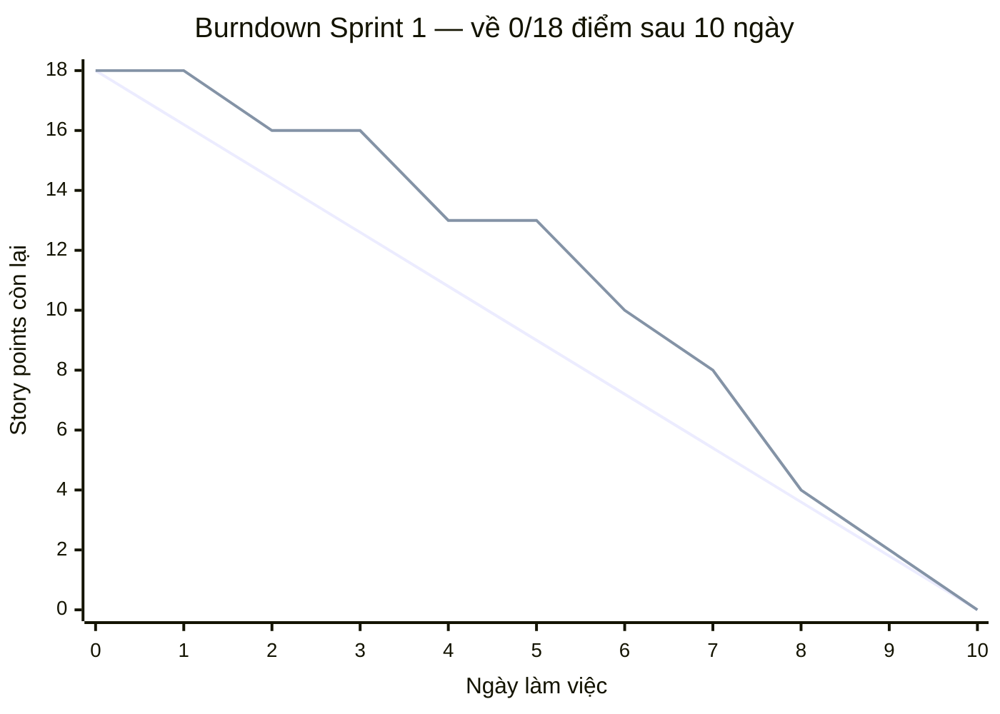

# Task 8 — Kế hoạch 3 Sprint + Sprint Backlog + Burndown chart mẫu

**Dự án BrewLite — Sprint 0**

> **Liên kết tài liệu liên quan trong kho lưu trữ (`docs/`):**
> - **Bản vẽ Wireframe 5 màn hình (HTML tương tác — Mục 7 PDF):** [../design/wireframe-5.html](../design/wireframe-5.html)
> - **Đặc tả giao diện Wireframe (Markdown):** [../design/wireframe.md](../design/wireframe.md)

---

## 1. Mục đích

Tài liệu này chia 10 task của Product Backlog (Mục 2.3 và Mục 8 trong đề bài `BrewLite-CongNghePhanMem.pdf`) thành 3 Sprint, lập Sprint Backlog chi tiết cho từng Sprint, và đưa ra một Burndown chart mẫu (Mục 2.4 trong đề bài) để nhóm theo dõi tiến độ hằng ngày.

---

## 2. Kế hoạch 3 Sprint (Theo Mục 2.3 Đề bài)

| Sprint | Mục tiêu (Sprint Goal) | Task (Product Backlog) | Story Points (Ước lượng nhóm) | Điểm đề bài |
| :--- | :--- | :--- | :---: | :---: |
| **Sprint 1** | Nền tảng & hiển thị menu | Task 1, 2, 3, 4 | 18 | 4 |
| **Sprint 2** | Giỏ hàng & đặt đơn & đăng nhập | Task 5, 6, 7 | 18 | 3 |
| **Sprint 3** | Thanh toán, bàn giao & nghiệp vụ nâng cao | Task 8, 9, 10 | 18 | 3 |
| **Tổng cộng** | **Hoàn thiện MVP BrewLite End-to-End** | **10 Task** | **54** | **10** |

Mỗi Sprint dự kiến kéo dài 1–2 tuần, kết thúc bằng buổi **Sprint Review (Demo)** và **Sprint Retrospective**.

---

## 3. Sprint Backlog chi tiết (Theo Mục 8 Đề bài)

### Sprint 1 — Nền tảng & hiển thị menu (18 Story Points)

| Task | Tên Task (Story) | Yêu cầu / Tiêu chí chấp nhận chính (Theo PDF) | Story Points | Người làm | Trạng thái |
| :--- | :--- | :--- | :---: | :---: | :--- |
| **Task 1** | Khởi tạo dự án và cấu trúc | Tạo monorepo/2 thư mục frontend (Next.js) + backend (NestJS), chạy được "Hello", có `README`, Git, `.env.example`. | 3 | — | Chưa làm |
| **Task 2** | API danh sách sản phẩm | NestJS `GET /products` trả về JSON menu (`id`, `name`, `price`, `imageUrl`) từ dữ liệu mẫu/CSDL. | 5 | — | Chưa làm |
| **Task 3** | Trang Menu (Frontend) | Next.js gọi `/products`, render lưới sản phẩm, có trạng thái `loading` / `empty state` ([Màn hình 1](../design/wireframe-5.html)). | 5 | — | Chưa làm |
| **Task 4** | Chi tiết và tùy chọn sản phẩm | Màn hình chi tiết: chọn size (`S`/`M`/`L`) và topping (`Trân châu`/`Kem`); tính giá theo tùy chọn ([Màn hình 2](../design/wireframe-5.html)). | 5 | — | Chưa làm |

### Sprint 2 — Giỏ hàng & đặt đơn & đăng nhập (18 Story Points)

| Task | Tên Task (Story) | Yêu cầu / Tiêu chí chấp nhận chính (Theo PDF) | Story Points | Người làm | Trạng thái |
| :--- | :--- | :--- | :---: | :---: | :--- |
| **Task 5** | Giỏ hàng (Cart) | Thêm/sửa số lượng/xóa; lưu state (Zustand/Context); tự tính tổng tiền; badge số lượng ([Màn hình 3](../design/wireframe-5.html)). | 5 | — | Chưa làm |
| **Task 6** | API tạo đơn hàng | NestJS `POST /orders` nhận giỏ hàng, validate (`class-validator`), lưu đơn trạng thái `PENDING`, trả mã đơn. | 5 | — | Chưa làm |
| **Task 7** | Đăng ký / Đăng nhập (JWT) | `POST /auth/register`, `/auth/login`: băm mật khẩu (`bcrypt`); phát JWT; guard bảo vệ route đặt đơn. | 8 | — | Chưa làm |

### Sprint 3 — Thanh toán, bàn giao & nghiệp vụ nâng cao (18 Story Points)

| Task | Tên Task (Story) | Yêu cầu / Tiêu chí chấp nhận chính (Theo PDF) | Story Points | Người làm | Trạng thái |
| :--- | :--- | :--- | :---: | :---: | :--- |
| **Task 8** | Thanh toán không tiền mặt | Tích hợp mock payment: chọn Ví/Thẻ, gọi `POST /payments`; đơn chuyển `PAID` khi thành công, `PAYMENT_FAILED` khi lỗi ([Màn hình 4](../design/wireframe-5.html)). | 5 | — | Chưa làm |
| **Task 9** | Xác nhận, lịch sử đơn & bàn giao | Màn hình xác nhận (mã đơn, trạng thái) ([Màn hình 5](../design/wireframe-5.html)) và `GET /orders/me` (lịch sử đơn); `docker-compose` chạy cả 3 (FE, BE, DB); `README`; demo end-to-end. | 5 | — | Chưa làm |
| **Task 10** | Nghiệp vụ backend | Order State Machine (`PENDING` $\rightarrow$ `PAID` $\rightarrow$ `PREPARING` $\rightarrow$ `READY` $\rightarrow$ `COMPLETED`), thanh toán idempotent (`Idempotency-Key`), kiểm soát tồn kho khi đặt đồng thời (transaction + optimistic locking), khuyến mãi/điểm thưởng (loyalty). | 8 | — | Chưa làm |

> **Ghi chú:**
> - Cột **"Người làm"** và **"Trạng thái"** sẽ được nhóm cập nhật trực tiếp trong buổi họp **Sprint Planning** đầu mỗi Sprint.
> - Cột **"Story Points"** là ước lượng độ phức tạp tương đối nội bộ của nhóm (18 điểm/Sprint); cột **"Điểm đề bài"** quy đổi mỗi Task hoàn thành đạt *Definition of Done* (Mục 10 PDF) tương ứng 1 điểm (tổng 10 điểm).

---

## 4. Burndown chart mẫu (Sprint 1 — 18 điểm, 10 ngày làm việc)

Biểu đồ dưới đây minh họa cách theo dõi khối lượng công việc còn lại (story points) giảm dần theo từng ngày trong Sprint 1 (2 tuần = 10 ngày làm việc), so sánh đường **Lý tưởng (Ideal)** (mục tiêu giảm đều) với đường **Thực tế (Actual)** (do nhóm cập nhật cuối mỗi ngày).

> **Note về hình ảnh biểu đồ:** Biểu đồ dưới đây được render trực tiếp bằng Mermaid.js trên GitHub/GitLab để không phụ thuộc vào file ảnh rời. Nếu nhóm xuất thêm file ảnh tĩnh từ Google Sheets/Word, file ảnh sẽ được lưu tại đường dẫn `docs/diagrams/burndown-sprint-1.png`.

### Bảng dữ liệu minh họa theo ngày

| Ngày làm việc | Ngày 0 | Ngày 1 | Ngày 2 | Ngày 3 | Ngày 4 | Ngày 5 | Ngày 6 | Ngày 7 | Ngày 8 | Ngày 9 | Ngày 10 |
| :--- | :---: | :---: | :---: | :---: | :---: | :---: | :---: | :---: | :---: | :---: | :---: |
| **Lý tưởng (Ideal)** | 18.0 | 16.2 | 14.4 | 12.6 | 10.8 | 9.0 | 7.2 | 5.4 | 3.6 | 1.8 | 0.0 |
| **Thực tế (Actual)** | 18 | 18 | 16 | 16 | 13 | 13 | 10 | 8 | 4 | 2 | 0 |

*(Số liệu minh họa cho Sprint 0, không phải dữ liệu thực tế)*

**Cách đọc (Theo Mục 2.4 Đề bài):**
- Nếu đường **Thực tế (Actual)** nằm **trên** đường **Lý tưởng (Ideal)** $\rightarrow$ nhóm đang **chậm tiến độ**.
- Nếu đường **Thực tế (Actual)** nằm **dưới** đường **Lý tưởng (Ideal)** $\rightarrow$ nhóm đang **vượt tiến độ**.
- Nhóm sử dụng biểu đồ này trong buổi họp **Daily Scrum (15 phút/ngày)** để phát hiện rủi ro sớm và điều chỉnh phạm vi Sprint.