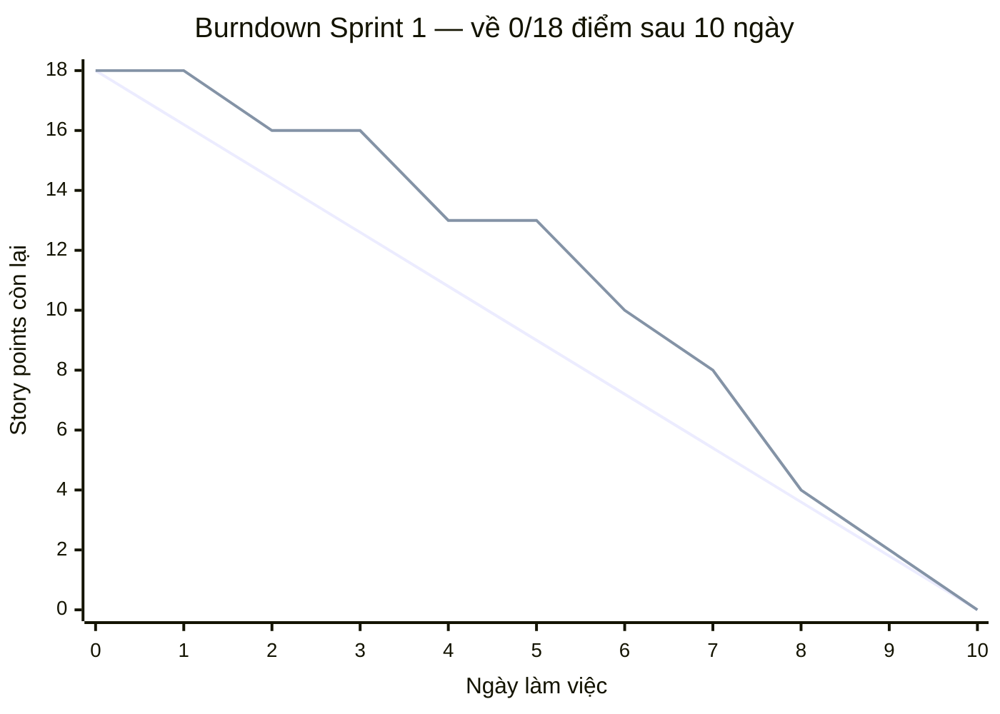

# Task 8 — Kế hoạch 3 Sprint + Sprint Backlog + Burndown chart mẫu
**Dự án BrewLite — Sprint 0**

---

## 1. Mục đích
Tài liệu này chia 10 task của Product Backlog (Mục 8 trong đề bài) thành 3 Sprint, lập Sprint Backlog chi tiết cho từng Sprint, và đưa ra một Burndown chart mẫu để nhóm theo dõi tiến độ hằng ngày.

---

## 2. Kế hoạch 3 Sprint

| Sprint       | Mục tiêu (Sprint Goal)                    | Task            | Tổng điểm |
| :----------- | :---------------------------------------- | :-------------- | :-------: |
| **Sprint 1** | Nền tảng & hiển thị menu                  | Task 1, 2, 3, 4 |    18     |
| **Sprint 2** | Giỏ hàng & đặt đơn & đăng nhập            | Task 5, 6, 7    |    18     |
| **Sprint 3** | Thanh toán, bàn giao & nghiệp vụ nâng cao | Task 8, 9, 10   |    18     |

Mỗi Sprint dự kiến kéo dài 1–2 tuần, kết thúc bằng Sprint Review (demo) và Sprint Retrospective.

---

## 3. Sprint Backlog chi tiết

### Sprint 1 — Nền tảng & hiển thị menu (18 điểm)

| Task       | Mô tả ngắn                                                 | Điểm  | Người làm | Trạng thái |
| :--------- | :--------------------------------------------------------- | :---: | :-------: | :--------- |
| **Task 1** | Khởi tạo dự án và cấu trúc (FE + BE, README, Git)          |   3   |     —     | Chưa làm   |
| **Task 2** | API danh sách sản phẩm `GET /products`                     |   5   |     —     | Chưa làm   |
| **Task 3** | Trang Menu (Frontend) gọi `/products`, loading/empty state |   5   |     —     | Chưa làm   |
| **Task 4** | Chi tiết sản phẩm: chọn size/topping, tính giá             |   5   |     —     | Chưa làm   |

### Sprint 2 — Giỏ hàng & đặt đơn & đăng nhập (18 điểm)

| Task       | Mô tả ngắn                                                      | Điểm  | Người làm | Trạng thái |
| :--------- | :-------------------------------------------------------------- | :---: | :-------: | :--------- |
| **Task 5** | Giỏ hàng: thêm/sửa/xóa, tự tính tổng tiền, badge số lượng       |   5   |     —     | Chưa làm   |
| **Task 6** | API tạo đơn hàng `POST /orders`, validate, trạng thái `PENDING` |   5   |     —     | Chưa làm   |
| **Task 7** | Đăng ký / Đăng nhập (JWT), băm mật khẩu, guard bảo vệ route     |   8   |     —     | Chưa làm   |

### Sprint 3 — Thanh toán, bàn giao & nghiệp vụ nâng cao (18 điểm)

| Task        | Mô tả ngắn                                                              | Điểm  | Người làm | Trạng thái |
| :---------- | :---------------------------------------------------------------------- | :---: | :-------: | :--------- |
| **Task 8**  | Thanh toán không tiền mặt (mock payment), `PAID` / `PAYMENT_FAILED`     |   5   |     —     | Chưa làm   |
| **Task 9**  | Xác nhận, lịch sử đơn, `docker-compose`, demo end-to-end                |   5   |     —     | Chưa làm   |
| **Task 10** | Nghiệp vụ backend nâng cao: State Machine, idempotent, tồn kho, loyalty |   8   |     —     | Chưa làm   |

> **Ghi chú:** Cột "Người làm" và "Trạng thái" để nhóm điền khi phân công trong Sprint Planning; điểm số là ước lượng tương đối (relative estimation), có thể điều chỉnh trong Sprint Planning thực tế.

---

## 4. Burndown chart mẫu (Sprint 1 — 18 điểm, 10 ngày làm việc)

Biểu đồ dưới đây minh họa cách theo dõi số điểm còn lại (story points) mỗi ngày trong Sprint 1, so sánh đường **Lý tưởng (Ideal)** (giảm đều) với đường **Thực tế (Actual)** (do nhóm cập nhật cuối mỗi ngày).

*(Lưu ý: Nếu bạn lưu hình ảnh biểu đồ từ file Word ra thư mục `docs/images/burndown-sprint-1.png`, ảnh sẽ tự động hiển thị tại đây. Ngoài ra, biểu đồ Mermaid và bảng số liệu tương đương bên dưới sẽ hiển thị trực tiếp trên GitHub/GitLab).*

### Bảng dữ liệu minh họa theo ngày

| Ngày làm việc        | Ngày 0 | Ngày 1 | Ngày 2 | Ngày 3 | Ngày 4 | Ngày 5 | Ngày 6 | Ngày 7 | Ngày 8 | Ngày 9 | Ngày 10 |
| :------------------- | :----: | :----: | :----: | :----: | :----: | :----: | :----: | :----: | :----: | :----: | :-----: |
| **Lý tưởng (Ideal)** |  18.0  |  16.2  |  14.4  |  12.6  |  10.8  |  9.0   |  7.2   |  5.4   |  3.6   |  1.8   |   0.0   |
| **Thực tế (Actual)** |   18   |   18   |   16   |   16   |   13   |   13   |   10   |   8    |   4    |   2    |    0    |

*(Số liệu minh họa, không phải dữ liệu thực tế)*

**Cách đọc:** Nếu đường **Thực tế** nằm trên đường **Lý tưởng**, nhóm đang chậm tiến độ; nằm dưới nghĩa là vượt tiến độ. Nhóm cập nhật số điểm còn lại cuối mỗi ngày trong Daily Scrum.