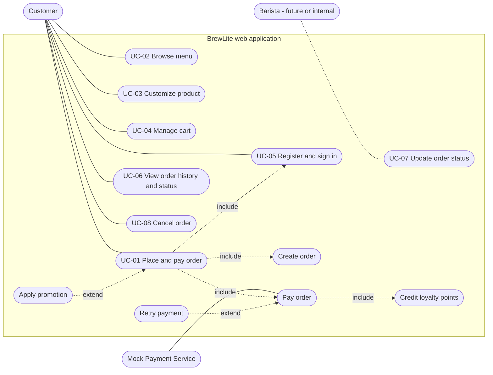

# BrewLite - Use-Case Overview

**Version:** 0.1  
**Status:** Draft for team review (task D-05)  
**Related:** [SRS](../requirements/srs.md), [UC-01 spec](../requirements/use-case-uc01-place-and-pay.md), [Context and scope](../requirements/context-and-scope.md)

This is the general use-case diagram of the whole system (Assignment 2, Task 1.2). Mermaid has no dedicated use-case diagram type, so this uses a flowchart: rounded shapes are actors and use cases, solid lines are associations, dashed lines marked `include` or `extend` are relationships between use cases. Export the diagram to SVG or PDF and save it next to this file (`use-case-overview.svg`), as Assignment 2 requires a rendered image.

## 1. Diagram

Reading notes:

- UC-01 includes UC-05 because an order needs a signed-in customer. If the customer is already signed in, that step is skipped.
- Crediting loyalty points is part of a successful payment, and happens once per order.
- UC-07 is used by the barista in a later extension; in this delivery it is an internal operation used for demos and tests.
- Stakeholders who do not use the system directly (store manager or Product Owner, instructor, development team) are not drawn as actors; see [context-and-scope.md](../requirements/context-and-scope.md#2-stakeholders).

## 2. Use-case list

| ID | Use case | Primary actor | Other actors | Requirements | Priority |
|---|---|---|---|---|---|
| UC-01 | Place and pay order (including create order, pay order, retry, promotion, loyalty) | Customer | Mock Payment Service | FR-05, FR-06, FR-07, FR-09, FR-10, FR-11, FR-12 | Must |
| UC-02 | Browse menu | Customer | - | FR-01 | Must |
| UC-03 | Customize product (size and toppings) | Customer | - | FR-02 | Must |
| UC-04 | Manage cart | Customer | - | FR-03 | Must |
| UC-05 | Register and sign in | Customer | - | FR-04 | Must |
| UC-06 | View order history and status | Customer | - | FR-08, FR-13 | Must (history), Should (single order) |
| UC-07 | Update order status | Barista (future), internal operation now | - | FR-09, FR-14 | Should |
| UC-08 | Cancel order | Customer | - | FR-15 | Could |

## 3. Relationship to the main flow

The Assignment 1 happy path maps to the use cases in this order: open the app and see the menu (UC-02), choose a product and options (UC-03), add it to the cart (UC-04), review the cart, sign in if needed (UC-05), pay without cash and receive confirmation (UC-01), and later view the order (UC-06). The detailed specification of UC-01 is in [use-case-uc01-place-and-pay.md](../requirements/use-case-uc01-place-and-pay.md).
