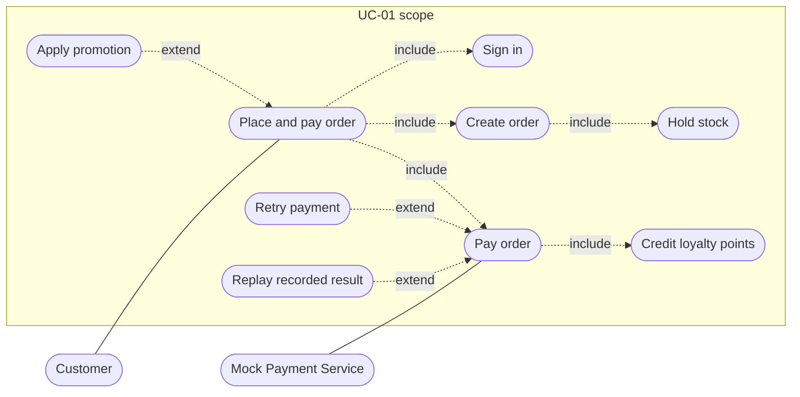

# BrewLite - Use Case UC-01: Place and Pay Order

**Version:** 0.1  
**Status:** Draft for team review (task D-06)  
**Related:** [SRS](srs.md), [Use-case overview](../diagrams/use-case-overview.md), [Context and scope](context-and-scope.md), [Testing plan](../plans/04-testing-plan.md)  
**Sources:** Assignment 1 (US-05, Task 6, 8, 10), Assignment 2 (Task 1.3)

UC-01 was chosen because it carries the core business value (turning a cart into a paid order) and covers every Task 10 rule. This specification is written so the acceptance scenarios in section 8 can be turned directly into tests. Items marked **(proposed)** are team suggestions to confirm; **(pending D-01)** items wait for the decision meeting.

## 1. Summary

| Field           | Value                                                                              |
| --------------- | ---------------------------------------------------------------------------------- |
| ID and name     | UC-01 Place and pay order                                                          |
| Primary actor   | Customer                                                                           |
| Secondary actor | Mock Payment Service (simulated Wallet and Card gateway)                           |
| User story      | US-05: as a customer, I want to pay by e-wallet or card so that I do not need cash |
| Goal            | Turn the items in the cart into a confirmed, paid order without cash               |
| Trigger         | The customer taps "Pay" (Thanh toan) on the cart screen                            |
| Requirements    | FR-05, FR-06, FR-07, FR-09, FR-10, FR-11, FR-12; NFR-03, NFR-04                    |
| Priority        | Must                                                                               |

## 2. Scope diagram

## 3. Preconditions

- The cart holds at least one item, and each item refers to an existing product with a valid size and toppings.
- The mock payment service is available.
- The customer is signed in, or can sign in during the flow (alternate flow A1).

## 4. Postconditions

**On success**
- The order has status `PAID` and a unique order ID.
- Exactly one payment is recorded for the order, with the idempotency key used.
- Stock for the ordered quantities is held and stays held.
- Loyalty points are credited once for the order.
- The cart is cleared and the confirmation screen shows the order ID and `PAID`.

**On failure**
- No order exists (E1, E2), or the order is `PAYMENT_FAILED` (E3), or `PENDING` (abandoned).
- Stock is never negative and never held twice for the same order.
- No loyalty points are credited.
- The cart contents are kept so the customer can retry.

## 5. Main flow

| Step | Actor                | Action                                                                                                                                         |
| ---- | -------------------- | ---------------------------------------------------------------------------------------------------------------------------------------------- |
| 1    | Customer             | Opens the cart; the system shows the items and a displayed total.                                                                              |
| 2    | Customer             | Taps "Pay". The system checks that the customer is signed in.                                                                                  |
| 3    | UI                   | Sends `POST /orders` with the items (product, size, toppings, quantity) and the JWT.                                                           |
| 4    | API                  | Validates the JWT and the request, reloads current prices and options, and calculates the authoritative total. Client-sent totals are ignored. |
| 5    | API                  | In one database transaction, checks stock with optimistic locking, holds the stock, and saves the order and items as `PENDING`.                |
| 6    | API                  | Returns the order ID, status `PENDING`, and the authoritative total.                                                                           |
| 7    | Customer             | Sees the checkout screen with the total, chooses Wallet or Card, and confirms.                                                                 |
| 8    | UI                   | Generates an `Idempotency-Key` and sends `POST /payments` with the order ID and method.                                                        |
| 9    | API                  | Validates the JWT, checks that the order belongs to the customer and is `PENDING`, and looks up the idempotency key: it is new.                |
| 10   | Mock Payment Service | Receives the charge request and returns success.                                                                                               |
| 11   | API                  | In one transaction, records the payment, moves the order `PENDING` to `PAID`, and credits loyalty points once.                                 |
| 12   | API                  | Returns the payment outcome and the order status `PAID`.                                                                                       |
| 13   | UI                   | Clears the cart and shows the confirmation with the order ID and status `PAID`.                                                                |

## 6. Alternate flows

| ID  | At step  | Condition                                                                              | Behavior                                                                                                                                                                                            |
| --- | -------- | -------------------------------------------------------------------------------------- | --------------------------------------------------------------------------------------------------------------------------------------------------------------------------------------------------- |
| A1  | 2        | The customer is not signed in                                                          | The UI sends the customer to register or sign in (UC-05) and keeps the cart. After sign-in the flow resumes at step 3.                                                                              |
| A2  | 1 or 7   | The customer wants to change the order                                                 | The customer returns to the cart (UC-04), edits it, and restarts at step 1. If an order is already `PENDING`, it stays pending until paid or cancelled.                                             |
| A3  | 3 to 7   | The customer enters a promotion code                                                   | The API validates the code and applies the discount to the authoritative total (rule pending D-01). An invalid or expired code is rejected with a message and the customer may continue without it. |
| A4  | After E3 | The customer retries payment                                                           | The order moves `PAYMENT_FAILED` to `PENDING`. The UI uses a **new** `Idempotency-Key` **(proposed)** and the flow continues at step 8.                                                             |
| A5  | 8 to 12  | The same payment request arrives again with the same key (double tap or network retry) | The API returns the recorded outcome. No second charge, payment record, or loyalty credit is made.                                                                                                  |
| A6  | 7        | The customer leaves checkout without paying                                            | The order stays `PENDING` with stock held until it is paid or cancelled (cancel rules and expiry pending D-01).                                                                                     |

## 7. Exception flows

| ID  | At step | Condition                                                                | System behavior                                                                                                                                                                               |
| --- | ------- | ------------------------------------------------------------------------ | --------------------------------------------------------------------------------------------------------------------------------------------------------------------------------------------- |
| E1  | 5       | Requested quantity exceeds available stock                               | The order is not created and stock is unchanged. The response is a conflict that names the affected item. The UI keeps the cart and lets the customer reduce the quantity or remove the item. |
| E2  | 4       | Invalid input: bad quantity, unknown product, size, or topping           | The request is rejected with a validation error. No order is created.                                                                                                                         |
| E3  | 10      | The payment is declined                                                  | The failure is recorded; the order moves `PENDING` to `PAYMENT_FAILED`. No loyalty points. Stock stays held. The UI shows the failure, keeps the cart, and offers a retry (A4) or cancel.     |
| E4  | 3 or 9  | JWT missing, invalid, or expired                                         | The request is rejected as unauthenticated. The UI sends the customer to sign in and keeps the cart.                                                                                          |
| E5  | 9       | The order does not exist or belongs to another customer                  | The request is rejected; no payment is made. Whether this returns "forbidden" or "not found" is decided in API design.                                                                        |
| E6  | 9       | The order is not payable (for example already `PAID`) and the key is new | The state machine rejects the transition; no second charge. The state is unchanged.                                                                                                           |
| E7  | 5       | Two orders update the same stock row at once (optimistic lock conflict)  | The API retries safely a limited number of times; if stock is no longer enough it returns the E1 conflict. Stock never goes negative.                                                         |
| E8  | 10      | The payment service is unreachable or times out                          | Treated as a failed payment **(proposed)**: the attempt is recorded and the order moves to `PAYMENT_FAILED`. The same key replays this result; a retry uses a new key.                        |
| E9  | 11      | A database error occurs while saving the result                          | The transaction rolls back; the order stays `PENDING`. The API returns a server error and the idempotency key and payment attempt record allow a safe retry.                                  |

## 8. Acceptance scenarios

These scenarios are the acceptance criteria for UC-01. The **Tests** column points to tasks in the [testing plan](../plans/04-testing-plan.md); concrete test IDs are assigned in T-01.

| ID    | Scenario                      | Given                                                     | When                                                         | Then                                                                                                                                  | Tests            |
| ----- | ----------------------------- | --------------------------------------------------------- | ------------------------------------------------------------ | ------------------------------------------------------------------------------------------------------------------------------------- | ---------------- |
| AC-01 | Successful payment            | A signed-in customer with one in-stock item in the cart   | Creates the order and pays by Wallet                         | The order is `PAID`; the order ID is shown; stock drops by the ordered quantity; one payment exists; loyalty points are credited once | T-04, T-09       |
| AC-02 | Failed payment keeps the cart | The mock gateway is set to fail                           | The customer pays                                            | The order is `PAYMENT_FAILED`; the cart is still available; no loyalty points                                                         | T-04, T-12, T-09 |
| AC-03 | Retry after failure           | An order is `PAYMENT_FAILED`                              | The customer retries with a new key and the gateway succeeds | The order becomes `PAID` once; stock is not held twice                                                                                | T-04             |
| AC-04 | Duplicate payment request     | A payment was already processed with key K                | The same request with key K is sent again                    | The same outcome is returned; there is exactly one payment and one effect                                                             | T-06             |
| AC-05 | Out of stock                  | The requested quantity is higher than stock               | The customer creates the order                               | No order is created; stock is unchanged; the cart is kept; the item is named in the error                                             | T-04, T-07       |
| AC-06 | Concurrent orders             | Stock is 1 and two customers order it at the same time    | Both create orders                                           | Exactly one succeeds; stock is never negative                                                                                         | T-07             |
| AC-07 | Not signed in                 | A customer has no JWT                                     | They try to create an order or pay                           | The request is rejected as unauthenticated; the cart is kept                                                                          | T-04, T-09       |
| AC-08 | Tampered client total         | The client sends a lower total or price                   | The order is created                                         | The order uses the server-calculated total                                                                                            | T-04             |
| AC-09 | Illegal transition            | An order is already `PAID`                                | A new payment with a new key is sent                         | The request is rejected; no second charge; status unchanged                                                                           | T-05, T-04       |
| AC-10 | Another customer's order      | Customer A owns an order                                  | Customer B tries to pay it                                   | The request is rejected; the order is unchanged                                                                                       | T-04             |
| AC-11 | Promotion                     | A valid and an invalid promotion code exist               | The customer applies each                                    | The valid code reduces the total; the invalid one is rejected                                                                         | T-08             |
| AC-12 | Loyalty credited once         | An order is paid and the same payment request is replayed | The replay is processed                                      | Loyalty points were credited only once                                                                                                | T-06, T-08       |
| AC-13 | Cancel releases stock (Could) | An order is `PENDING` with stock held                     | The order is cancelled                                       | Held stock is released exactly once; a second cancel changes nothing                                                                  | T-07             |

## 9. API calls used

Status codes are proposals to confirm during API design.

| Step    | Call             | Key inputs                                                                 | Success result                                  | Error results                                                                                                                                                       |
| ------- | ---------------- | -------------------------------------------------------------------------- | ----------------------------------------------- | ------------------------------------------------------------------------------------------------------------------------------------------------------------------- |
| 3 to 6  | `POST /orders`   | JWT; items with product, size, toppings, quantity; optional promotion code | Order ID, status `PENDING`, authoritative total | 400 invalid input; 401 unauthenticated; 409 insufficient stock                                                                                                      |
| 8 to 12 | `POST /payments` | JWT; `Idempotency-Key` header; order ID; method (Wallet or Card)           | Outcome and order status `PAID`                 | 400 missing key or invalid input; 401 unauthenticated; 403 or 404 not the owner; 409 order not payable; failed payment returns outcome with status `PAYMENT_FAILED` |

## 10. Business rules applied

- Order states and transitions follow the [state machine in the SRS](srs.md#5-order-state-machine).
- Stock is held at order creation and released once on cancel (SRS section 6.1).
- The server calculates all prices and totals.
- A payment retry after a failure uses a new idempotency key; the same key replays the recorded result **(proposed)**.
- Loyalty points are credited once per paid order.

## 11. UI screens involved

Cart, checkout (payment method), and confirmation, from the Assignment 1 wireframes (screens 3, 4, and 5), plus the sign-in screen for alternate flow A1.

## 12. Open items

- Promotion rule and loyalty formula (pending D-01, items 9 and the pricing rule).
- Cancel rules, refund handling, and retry expiry (pending D-01, item 8).
- Whether a customer can cancel from the checkout screen.
- Exact HTTP status codes and error body format (API design).
- Handling of a payment service timeout in a real provider; for the mock, E8 applies.
