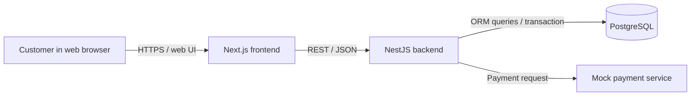
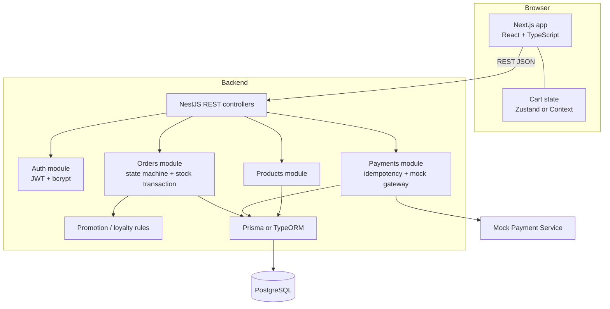
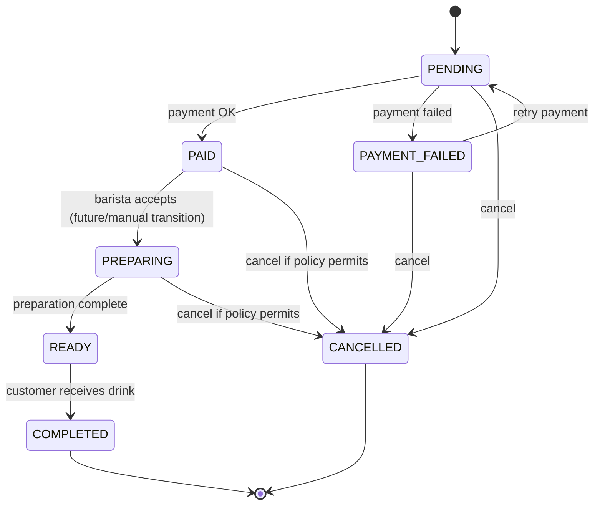
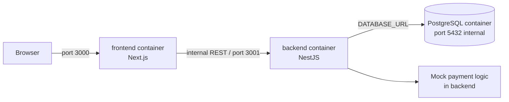

# BrewLite - Architecture

**Version:** 1.0  
**Status:** Draft baseline  
**Related:** [Requirements](requirements.md), [Traceability matrix](traceability-matrix.md), [Deployment](deployment.md)

## 1. Architectural goals

- Deliver the assignment's customer MVP with the mandated Next.js frontend and NestJS backend.
- Keep the UI, business rules, persistence, and mock payment boundary understandable and independently changeable.
- Make payment retries safe and inventory updates correct under concurrent orders.
- Run the complete stack locally through Docker Compose for the demo and handover.

## 2. System context

Customer-facing browser UI supports menu, product detail, cart, authentication, checkout, confirmation, and order history. Barista operations and real external payment providers are outside the MVP.

## 3. Runtime components

### 3.1 Frontend

- Next.js, React, TypeScript, and TailwindCSS.
- Calls backend REST endpoints; renders menu and checkout states.
- Cart state uses Zustand or React Context (choose one during implementation).
- Cart total shown in UI is for interaction; backend recalculates authoritative prices and totals from product/options data to prevent trusting client-submitted totals.

### 3.2 Backend

- NestJS modules: Auth, Products, Orders, Payments; shared validation/configuration as needed.
- REST endpoints use DTO validation (`class-validator`).
- Passport JWT guard protects user-specific operations.
- Order domain owns state transition validation and transactional stock reservation/decrement.
- Payment domain owns idempotency-key lookup/recording and mock gateway orchestration.
- Promotion and loyalty rules are applied server-side. Loyalty award must be idempotent per order.

### 3.3 Persistence

- PostgreSQL with Prisma or TypeORM (assignment allows either; **decision pending**).
- Minimum entities and fields are defined in [Requirements](requirements.md#6-business-rules-and-data).
- Use database transactions for order creation, stock updates, and payment state changes where they must commit atomically.
- Optimistic locking/version check guards stock writes; on conflict, retry safely or return an insufficient-stock/conflict response.
- Store unique idempotency key scoped appropriately (recommended: user plus key) and enforce uniqueness in the database.

## 4. Key flows

### 4.1 Browse and create order

1. Browser fetches `GET /products` and displays menu.
2. Customer configures item and manages cart locally.
3. Customer signs in/registers; frontend sends JWT on protected requests.
4. Frontend submits item identifiers/options/quantities to `POST /orders`.
5. Backend validates DTO and ownership, reloads current product prices, calculates totals, checks stock, then persists order/items and stock changes transactionally in `PENDING`.
6. Backend returns order identifier and current status.

### 4.2 Payment

1. Frontend submits order ID, payment method, and `Idempotency-Key` to `POST /payments`.
2. Backend authenticates owner and checks whether that key already has a recorded result.
3. For a new key, backend invokes mock gateway and records payment outcome with order state transition.
4. Success yields `PAID`; failure yields `PAYMENT_FAILED`; duplicate same-key request returns the original result without a second charge.
5. Successful payment grants loyalty points once and applies promotion according to the selected policy.

**Assumption to confirm:** the assignment describes creating an order as `PENDING` and failed payment as `PAYMENT_FAILED`, while payment retry behavior is shown in the diagram. The implementation should define whether failed attempts update the order or a payment-attempt record and preserve a retry path consistently.

## 5. Order state machine

The brief requires the happy-path transitions and rejects transitions without an allowed edge. Cancellation edges and retry semantics should match the final policy and tests. Barista-driven transitions are outside customer MVP and can be invoked through seed/demo or an internal operation for Task 10.

## 6. Security and reliability

- Hash passwords with bcrypt; never return password hashes.
- Validate and constrain all incoming DTOs; derive user identity from JWT, not request body.
- Scope order and payment access to authenticated owner.
- Use database constraints for uniqueness and nonnegative stock where feasible.
- Make payment and loyalty effects idempotent.
- Never trust frontend prices, totals, user ID, or payment outcome.
- Keep secrets in environment configuration; provide `.env.example` with placeholders only.

## 7. Deployment view

Docker Compose runs frontend, backend, and PostgreSQL, with persistent database volume and health/dependency checks. See [Deployment](deployment.md) for the runbook.

## 8. Technology decisions

| Concern | Baseline | Status |
|---|---|---|
| Frontend | Next.js, React, TypeScript, TailwindCSS | Required/baseline |
| Cart state | Zustand or Context | Choose one during implementation |
| Backend | NestJS, TypeScript, REST, class-validator, Passport JWT | Required/baseline |
| Database | PostgreSQL | Assignment recommendation |
| ORM | Prisma or TypeORM | Team decision pending |
| Payments | Mock payment service | Required for assignment scope |
| Local deployment | Docker Compose | Required for handover |

## 9. Quality attributes

- Performance target: API response under 500 ms with sample data; refine test conditions before claiming compliance.
- Browser compatibility: current mainstream browsers; define exact versions in implementation README.
- Maintainability: domain logic stays in NestJS modules/services and is not duplicated as authoritative behavior in the UI.
- Testability: state transitions, idempotency, and concurrent stock handling have focused unit/integration tests per Task 10.

## 10. Risks and unresolved decisions

- ORM selection and migration strategy.
- Price model for sizes/toppings and promotion/loyalty policies.
- Atomic boundary between mock gateway and database; use idempotency and recorded payment attempts to recover from partial failure.
- Meaning of stock (finished drinks versus ingredients); brief's minimum model supports product stock, while Task 10 says ingredients/products.
- Cancellation policy and whether a paid order may be cancelled.
