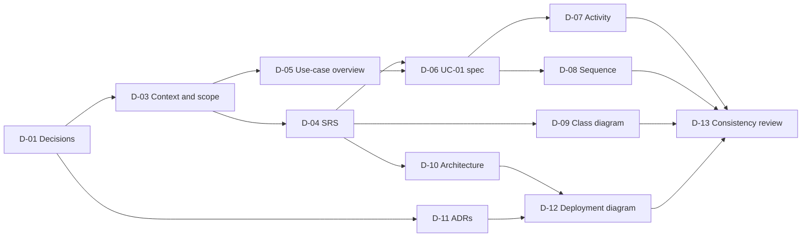

# BrewLite - Documentation and Analysis Plan

**Version:** 1.0  
**Status:** Draft for team review  
**Back to:** [Overview](00-overview.md)  
**Related plans:** [Setup and DevOps](02-setup-devops-plan.md), [Implementation](03-implementation-plan.md), [Testing](04-testing-plan.md), [Payment](05-payment-plan.md)

Covers requirements, modeling, architecture, traceability, and handover documents. Column meanings and ID rules are explained in the [overview](00-overview.md#2-how-to-read-a-plan).

## 1. Task list

| ID | Task | Output | Phase | Needs | Priority | Owner | Status |
|---|---|---|---|---|---|---|---|
| D-01 | Decision meeting and log (section 3) | Decisions recorded; ADR drafts | P0 | - | Must | | Todo |
| D-02 | Move existing docs into the `docs/` layout and close the gaps in section 2 | Files at target paths; PR with reasons | P1 | S-01, D-01 | Must | | Todo |
| D-03 | Context and scope: stakeholder table (goals), in-scope, out-of-scope, assumptions, constraints, initial risks (A2-T1.1) | `docs/requirements/context-and-scope.md` | P1 | D-01 | Must | | Todo |
| D-04 | SRS: FR and NFR with IDs, MoSCoW (Must, Should, Could, Won't), testable acceptance criteria; minimum groups: menu, product detail, cart, auth, order, payment, history, order state, performance, security, usability, deployability (A2-T1.2) | `docs/requirements/srs.md` | P1 | D-03 | Must | | Todo |
| D-05 | General use-case diagram of the whole system (A2-T1.2) | `docs/diagrams/use-case-overview.*` | P1 | D-03 | Must | | Todo |
| D-06 | Use-case spec for UC-01 "Place and pay order": actor, trigger, pre/postconditions, main, alternate, and exception flows, linked requirement IDs, scoped use-case diagram (A2-T1.3) | `docs/requirements/use-case-uc01-place-and-pay.md` | P1 | D-04, D-05 | Must | | Todo |
| D-07 | Activity diagram: swimlanes, decisions and merges; covers out of stock, not signed in, payment failed (A2-T2.1) | `docs/diagrams/activity-checkout.*` | P2 | D-06 | Must | | Todo |
| D-08 | Sequence diagram for UC-01: lifelines Customer, Next.js UI, NestJS API, Database, Payment Service; JWT check, validation, transaction, alt success/failure, idempotent retry, final result (A2-T2.2) | `docs/diagrams/sequence-checkout.*` (source plus rendered SVG/PDF) | P2 | D-06, D-01 | Must | | Todo |
| D-09 | Class diagram: `User`, `Product`, `Order`, `OrderItem`, `Payment`, `Promotion`, `LoyaltyTransaction`; attributes, relations, multiplicity, status enum; plus data model (A2-T2.3) | `docs/diagrams/class-domain.*` | P2 | D-04, D-01 | Must | | Todo |
| D-10 | Architecture description in C4 or layered form: frontend (PWA), backend modules, PostgreSQL and migrations, mock payment, logging, health check, configuration, trade-offs (A2-T3.1) | `docs/architecture/architecture.md` | P2 | D-04, D-01 | Must | | Todo |
| D-11 | One ADR per significant decision from D-01 (A2-T3.1) | `docs/architecture/adr/NNN-*.md` | P2 | D-01 | Must | | Todo |
| D-12 | UML deployment diagram for production on the platform actually used (A2-T3.2); every node traces to an architecture component and to code | `docs/diagrams/deployment-production.*` | P3 | D-10, D-11 | Must | | Todo |
| D-13 | Consistency review: SRS, use case, three diagrams, data model, state machine, API list agree | Review checklist in a PR | P3 | D-07 to D-12 | Must | | Todo |
| D-14 | Traceability matrix in the Assignment 2 format: Requirement, Use-case/User Story, Design/Diagram, Code/API, Test. Skeleton in P2, final in P7 | [`docs/traceability-matrix.md`](../traceability-matrix.md) | P2 to P7 | D-04, D-06, T-01 | Must | | In progress (skeleton in review) |
| D-15 | Deployment guide: local, production, rollback | `docs/deployment.md` | P7 | S-07, S-08 | Must | | Todo |
| D-16 | README: run locally, test, build, deploy, rollback. Skeleton in P0, final in P7 | [`README.md`](../../README.md) | P0 to P7 | S-01 | Must | | In progress (skeleton in review) |
| D-17 | Scrum artifacts: sprint backlogs, burndown, review and retrospective notes, customer feedback | `docs/scrum/` (proposed folder) | P1 to P7 | S-02 | Must | | Todo |
| D-18 | Release notes, demo video script, submission checklist | `docs/release-notes.md`, checklist | P7 | all | Must | | Todo |

Diagram files marked `*` have a source file and a rendered image (`.svg` or `.pdf`). Confirm with the instructor that Mermaid source is acceptable; if PlantUML is required, use `.puml`.

## 2. Gaps in the existing documents

The five existing files (`requirements.md`, `diagrams.md`, `architecture.md`, `deployment.md`, `traceability-matrix.md`) already have the contradictions fixed. These remaining gaps are closed by the tasks shown.

| Gap | Closed by |
|---|---|
| Not in the Assignment 2 folder layout | D-02 |
| No stakeholder goals table, out-of-scope list, or risk list | D-03 |
| All requirements marked "Must"; no Should, Could, Won't | D-04 |
| Missing NFRs: mobile-first/PWA, availability, health and logging, usability, deployability | D-04 |
| No use-case diagram or use-case spec | D-05, D-06 |
| No activity diagram | D-07 |
| Sequence diagram lacks JWT check, DTO validation, out-of-stock branch | D-08 |
| No class diagram; `OrderItem` has no topping field; `Promotion` and `LoyaltyTransaction` missing | D-09 |
| No C4 or layered justification, trade-offs, logging, health, config, migration section | D-10 |
| No ADRs | D-11 |
| No production deployment diagram or production runbook | D-12, D-15 |
| API list lacks `GET /health`, `GET /orders/:id`, and an internal status-transition operation | D-04, D-10 |
| Traceability matrix is keyed to Assignment 1 tasks; no use-case, diagram, or test IDs | D-14 |
| Only Assignment 1's three-sprint plan is documented | D-17 |
| Mermaid `\n` line breaks in node labels may render literally; verify rendering | D-13 |

## 3. Decision checklist (D-01)

Decide these in the P0 meeting. Record each as an ADR (D-11).

| # | Decision | Options | Blocks |
|---|---|---|---|
| 1 | ORM | Prisma or TypeORM | C-03, S-04, D-09, D-10 |
| 2 | Cart state | Zustand or React Context | C-16 |
| 3 | Hosting platform | Render, Railway, Fly.io, Azure, AWS, VPS | S-06, S-07, D-12 |
| 4 | Payment approach | See [05-payment-plan.md](05-payment-plan.md) | C-07, D-08 |
| 5 | Currency and rounding | Suggested: whole VND as integers | C-06, C-15 |
| 6 | Size and topping pricing | Fixed surcharges per size and topping | C-15, C-06, D-04 |
| 7 | Stock unit | Finished drinks per product (matches minimum data model) or ingredients | C-11, D-09 |
| 8 | Cancellation details and retry expiry | Who may cancel; refund handling for `PAID`; expiry window | C-09, D-06 |
| 9 | Promotion and loyalty rules | Code format, discount type, points per amount | C-12, D-04 |
| 10 | Diagram format | Mermaid with exported images, or PlantUML | D-05 to D-09, D-12 |
| 11 | Test tools | Jest, Supertest, test database, Playwright or Cypress | T-01, T-02 |
| 12 | Performance test method | Sample size, request mix, environment | T-10 |
| 13 | Browser support baseline | Exact browsers and versions | T-11, D-04 |

Fixed already by the assignment diagram: `CANCELLED` is reachable only from `PENDING`, `PAYMENT_FAILED`, and `PAID`. Stock is held at order creation and released once on cancel (see [architecture.md](../architecture/architecture.md)).

## 4. Dependency view

