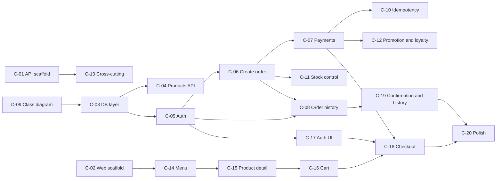

# BrewLite - Implementation Plan

**Version:** 1.0  
**Status:** Draft for team review (detailed codebase design to follow)  
**Back to:** [Overview](00-overview.md)  
**Related plans:** [Documentation](01-documentation-plan.md), [Setup and DevOps](02-setup-devops-plan.md), [Testing](04-testing-plan.md), [Payment](05-payment-plan.md)

Covers code in `apps/api` (NestJS) and `apps/web` (Next.js). Column meanings are in the [overview](00-overview.md#2-how-to-read-a-plan). The internal code structure will be detailed in a later document; this plan lists tasks and dependencies only.

## 1. Backend tasks (`apps/api`)

| ID | Task | Output | Phase | Needs | Priority | Owner | Status |
|---|---|---|---|---|---|---|---|
| C-01 | Scaffold the API: NestJS, configuration, global ValidationPipe, "Hello" (A1-T1) | Runnable `apps/api` | P1 | S-01 | Must | | Todo |
| C-03 | Database layer: ORM setup, schema for all entities (including toppings on order items, `Promotion`, `LoyaltyTransaction`), migrations, seed data | `apps/api/prisma/` (schema, migrations, seed); `db:*` scripts | P2 | D-01, D-09 (draft) | Must | | Review |
| C-04 | Products module: `GET /products`, `GET /products/:id`; `GET /health`; request logging (A1-T2) | Endpoints | P3 | C-03 | Must | | Todo |
| C-09 | Order state machine with `assertTransition`; internal operation to move an order through `PREPARING`, `READY`, `COMPLETED` for demo (A1-T10) | Domain service and internal endpoint | P3 | D-01 (cancel policy) | Must | | Todo |
| C-05 | Auth module: `POST /auth/register`, `POST /auth/login`, bcrypt hashing, JWT, Passport guard (A1-T7) | Endpoints and guard | P4 | C-03 | Must | | Todo |
| C-13 | Cross-cutting: CORS limited to the frontend origin, consistent error format, exception filter | Shared backend config | P4 | C-01 | Must | | Todo |
| C-06 | Orders module: `POST /orders` validates the DTO, recalculates prices server-side, holds stock transactionally, saves the order as `PENDING` (A1-T6) | Endpoint | P4 | C-03, C-05 | Must | | Todo |
| C-07 | Payments module: `PaymentProvider` interface, mock gateway, `POST /payments` with `Idempotency-Key`; success gives `PAID`, failure gives `PAYMENT_FAILED` (A1-T8). Details in [05-payment-plan.md](05-payment-plan.md) | Endpoint and provider | P5 | C-06, D-01 (payment decision) | Must | | Todo |
| C-10 | Idempotency: unique key per user in the database; replay returns the recorded outcome with one effect (A1-T10) | DB constraint and replay logic | P5 | C-07 | Must | | Todo |
| C-11 | Stock control: transaction plus optimistic locking; release stock once on `CANCELLED` (A1-T10) | Stock service | P5 | C-06 | Must | | Todo |
| C-08 | `GET /orders/me` (current user only) and `GET /orders/:id` (owner only) (A1-T9) | Endpoints | P5 | C-05, C-06 | Must | | Todo |
| C-12 | Promotion and loyalty: apply a valid promotion; credit points once per paid order (A1-T10) | Services | P6 | C-07, D-01 | Must | | Todo |

## 2. Frontend tasks (`apps/web`)

| ID | Task | Output | Phase | Needs | Priority | Owner | Status |
|---|---|---|---|---|---|---|---|
| C-02 | Scaffold the web app: Next.js, TypeScript, Tailwind, mobile-first layout, PWA manifest (A1-T1) | Runnable `apps/web` | P1 | S-01 | Must | | Todo |
| C-14 | Menu page: calls `/products`, product grid, loading, empty, and error states (A1-T3) | Page | P3 | C-02; API contract (may mock until C-04) | Must | | Todo |
| C-15 | Product detail: choose size S/M/L and toppings; price follows the pricing rule (A1-T4) | Page | P4 | C-14, D-01 (pricing) | Must | | Todo |
| C-16 | Cart: state (Zustand or Context), add, edit quantity, remove, totals, count badge (A1-T5) | Cart state and page | P4 | C-15 (may start on static data), D-01 (cart state) | Must | | Todo |
| C-17 | Register and login pages, token handling, route guard (A1-T7) | Pages | P4 | C-05 contract | Must | | Todo |
| C-18 | Checkout: Wallet or Card choice, `Idempotency-Key` generation, failure and retry with the cart kept (A1-T8) | Page | P6 | C-07, C-16, C-17 | Must | | Todo |
| C-19 | Confirmation page (order ID, status) and order history and tracking page (A1-T9) | Pages | P6 | C-08 | Must | | Todo |
| C-20 | Mobile and PWA polish, error boundaries, basic accessibility | UI polish | P6 | C-18, C-19 | Should | | Todo |

Optional payment tasks `C-21` (QR demo provider, P6) and `C-22` (sandbox gateway adapter, P7) are in [05-payment-plan.md](05-payment-plan.md).

## 3. API baseline

`proposed` rows are not in the assignment and need confirmation in `D-04`.

| Method | Path | Access | Task |
|---|---|---|---|
| GET | `/products` | Public | C-04 |
| GET | `/products/:id` | Public | C-04 |
| POST | `/auth/register` | Public | C-05 |
| POST | `/auth/login` | Public | C-05 |
| POST | `/orders` | JWT | C-06 |
| POST | `/payments` | JWT, order owner | C-07 |
| GET | `/orders/me` | JWT | C-08 |
| GET | `/orders/:id` (proposed) | JWT, order owner | C-08 |
| GET | `/health` (proposed) | Public | C-04 |
| internal status transition (proposed) | restricted | C-09 |

## 4. Data model notes

Minimum entities from Assignment 1: `Product`, `User`, `Order`, `OrderItem`, `Payment`. Assignment 2 adds `Promotion` and `LoyaltyTransaction`. The final model is in [class-domain.md](../diagrams/class-domain.md) (`D-09`) and in `apps/api/prisma/schema.prisma` (`C-03`): toppings through `OrderItemTopping`, and `Order.stockHeld` so release on cancel happens once.

## 5. Dependency view

`C-09` (state machine) depends only on the cancel-policy decision and can start as soon as it is made.
