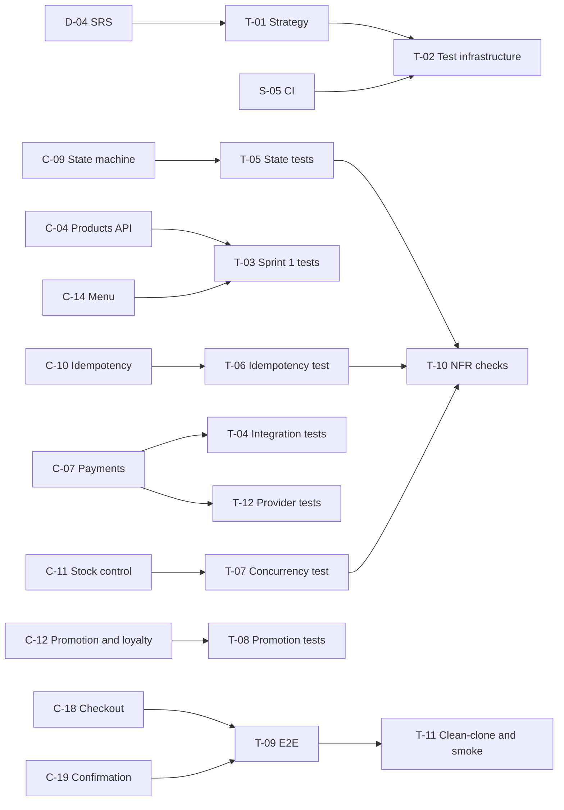

# BrewLite - Testing Plan

**Version:** 1.0  
**Status:** Draft for team review  
**Back to:** [Overview](00-overview.md)  
**Related plans:** [Documentation](01-documentation-plan.md), [Setup and DevOps](02-setup-devops-plan.md), [Implementation](03-implementation-plan.md), [Payment](05-payment-plan.md)

Covers tests in `apps/api`, `apps/web`, and `tests/`. Column meanings are in the [overview](00-overview.md#2-how-to-read-a-plan).

## 1. Task list

| ID | Task | Output | Phase | Needs | Priority | Owner | Status |
|---|---|---|---|---|---|---|---|
| T-01 | Test strategy: levels, tools, test ID convention, list of test cases linked to requirement IDs | [`docs/testing/test-strategy.md`](../testing/test-strategy.md) | P2 | D-04, D-01 (test tools) | Must | | Review |
| T-02 | Test infrastructure: test database, test runner configuration (Vitest, see ADR 015), E2E tool setup, test job in CI | Config and CI job | P3 | T-01, S-05 | Must | | Todo |
| T-03 | Sprint 1 tests: products API (unit and integration), menu component and loading, empty, error states (A2-T4.3) | Tests | P3 | C-04, C-14 | Must | | Todo |
| T-05 | State machine unit tests: legal path allowed; illegal transitions rejected, including cancel from `PREPARING` and `READY`; terminal states (Task 10 criterion a) | Tests | P3 | C-09 | Must | | Todo |
| T-04 | Integration tests: auth (hash stored, JWT issued, 401/403), order creation (valid gives `PENDING`, invalid rejected), payment success and failure | Tests | P5 | C-05, C-06, C-07, C-08 | Must | | Todo |
| T-06 | Idempotency: same `Idempotency-Key` sent twice gives one payment and one order effect (Task 10 criterion b) | Integration test | P5 | C-10 | Must | | Todo |
| T-07 | Concurrency: parallel orders cannot exceed stock; stock never negative; cancel releases stock once (Task 10 criterion c) | Integration test | P5 | C-11 | Must | | Todo |
| T-12 | Payment provider tests: mock outcomes are controllable; the provider interface behaves the same for every provider | Tests | P5 | C-07 | Must | | Todo |
| T-08 | Promotion applied when valid; loyalty points credited once per paid order | Tests | P6 | C-12 | Must | | Todo |
| T-09 | End-to-end: menu, product, cart, sign in, pay, confirmation with order ID and `PAID` (A2-T5.2) | E2E test in `tests/` | P6 | C-18, C-19, S-04 | Must | | Todo |
| T-10 | Non-functional checks: API under 500 ms with documented sample data, bcrypt hashes in the database, authorization and validation negative cases | Script and results | P7 | all C tasks | Must | | Todo |
| T-11 | Clean-clone test by a non-team member following the README; production smoke test | Notes and evidence | P7 | S-08, D-16 | Must | | Todo |

## 2. Required evidence

Assignment 1, Task 10 requires unit or integration tests proving:

- **(a)** invalid state transitions are blocked (T-05);
- **(b)** two requests with the same `Idempotency-Key` produce one effect (T-06);
- **(c)** concurrent orders do not exceed stock (T-07).

Assignment 2, Task 5.2 requires: unit tests for important business logic, integration tests for order and payment APIs, at least one E2E test from menu to confirmation, reproducible migration and seed, `docker-compose.yml`, and a health endpoint.

## 3. Test levels and locations

| Level | Where | Tools (ADR 011, ADR 015) |
|---|---|---|
| Unit | `apps/api`, `apps/web` next to code | Vitest (ADR 015); React Testing Library |
| Integration | `apps/api/test` against a PostgreSQL test database | Vitest with Supertest |
| End-to-end | `tests/e2e/` against the Compose stack | Playwright (decision 11) |
| Non-functional | `tests/nfr/` scripts | `autocannon` (decision 12); manual browser smoke test |

Test IDs follow the Assignment 2 example style (`API-T01`, `INT-T03`). Add a prefix per level, for example `UNIT-`, `API-`, `INT-`, `E2E-`, `NFR-`. Every test ID must appear in the traceability matrix ([D-14](../traceability-matrix.md)). The full list of test IDs is in the [test strategy](../testing/test-strategy.md#7-test-case-list).

## 4. Requirement to test map

| Requirement | Tests |
|---|---|
| FR-01 Browse drinks | T-03, T-09 |
| FR-02 Customize drink | T-09 (UI check) |
| FR-03 Cart | T-09 (UI check) |
| FR-04 Register and sign in | T-04 |
| FR-05 Create order | T-04 |
| FR-06 Pay | T-04, T-12, T-09 |
| FR-07 Confirm order | T-09 |
| FR-08 Order history | T-04 |
| FR-09 State machine | T-05 |
| FR-10 Idempotent payment | T-06 |
| FR-11 Stock under concurrency | T-07 |
| FR-12 Promotion and loyalty | T-08 |
| NFR-01 Performance | T-10 |
| NFR-02 Password hashing | T-04, T-10 |
| NFR-03 JWT protection | T-04, T-10 |
| NFR-04 Validation | T-04, T-10 |
| NFR-05 Browser support | T-11 |
| NFR-06 Run and handover | T-11 |
| NFR-07 UI states | T-03, T-09 |

This map lists the tasks per requirement for FR-01 to FR-12 and NFR-01 to NFR-07. The test IDs for every requirement in the [SRS](../requirements/srs.md), including FR-13 to FR-18 and NFR-08 to NFR-15, are in the [test strategy coverage summary](../testing/test-strategy.md#8-coverage-summary).

## 5. Dependency view

