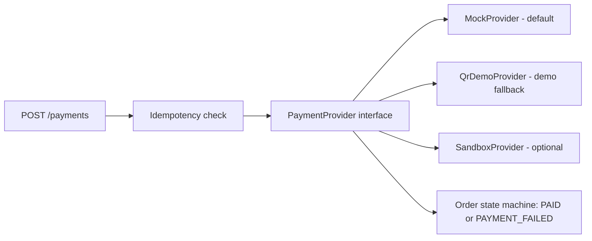

# BrewLite - Payment Plan

**Version:** 1.0  
**Status:** Draft for team review; the approach in section 3 needs a team decision (D-01 item 4)  
**Back to:** [Overview](00-overview.md)  
**Related plans:** [Documentation](01-documentation-plan.md), [Implementation](03-implementation-plan.md), [Testing](04-testing-plan.md)

## 1. Problem

The team cannot confirm that a customer has paid when the checkout only shows a screenshot of a bank QR code. The project uses fake money only; it does not move real funds. The team needs a way to test the full payment flow (success, failure, retry, idempotency) without real money.

## 2. Options

| Option | How it works | Can it confirm payment? | Effort | Fit |
|---|---|---|---|---|
| A. Mock Payment Service in the backend | Backend simulates the gateway and returns success or failure on request | Yes, by design (it is the simulation) | Low | Required by the assignment; recommended primary |
| B. Static bank QR screenshot | Show a fixed QR image | No. Nothing tells the system a transfer happened | Low | Not suitable as the only method |
| C. Dynamic bank QR (temporary) | Generate a QR with the team's bank ID, the order total, and the order code as the transfer note; display only | No on its own. Pair it with a simulated confirmation (section 4) | Low to medium | Temporary demo fallback |
| D. Real sandbox gateway | Register for a provider's test environment and use test money (VNPay and MoMo both advertise sandbox or test environments; Stripe has test mode) | Yes, through the provider's redirect and callback | High: credentials, signature handling, callback URL | Optional stretch |

Notes on D: confirm each provider's current registration steps and sandbox documentation before committing. A callback from the provider needs a public URL, so local development would need a tunnel.

## 3. Recommended approach

Use option A as the main implementation, option C only as a labeled demo fallback, and option D as an optional stretch. All options go through one interface so the order state machine, idempotency, and stock rules behave the same regardless of provider.

Rules:

- The provider only reports an outcome. Idempotency, the order state change, and loyalty crediting happen outside the provider.
- The mock outcome must be controllable in non-production mode so tests are deterministic, for example by a test amount, a magic value, or a configuration flag. Never expose this control in production.
- Keep the team's bank ID and account number in environment variables, not in the repository.
- Label any QR demo clearly as "demo only, no real transfer".

Record the final choice as an ADR (D-11).

## 4. QR demo fallback (C-21)

1. Backend builds the QR content from `BANK_ID`, `ACCOUNT_NO`, the order total, and the order code as the note. Check the QR format against the VietQR documentation before relying on it.
2. The checkout screen shows the QR and the order code.
3. A "simulate payment received" control, available in demo mode only, calls the same payment confirmation path as the mock provider. This keeps state transitions and idempotency exercised.
4. Without step 3, a QR alone cannot tell the system that money arrived.

## 5. Tasks

| ID | Task | Output | Phase | Needs | Priority | Owner | Status |
|---|---|---|---|---|---|---|---|
| D-01 (item 4) | Decide the payment approach and record it as an ADR | ADR in `docs/architecture/adr/` | P0 to P2 | - | Must | | Todo |
| C-07 | `PaymentProvider` interface, `MockProvider` with controllable outcomes, `POST /payments` with `Idempotency-Key` | Code in `apps/api` | P5 | C-06, D-01 | Must | | Todo |
| T-12 | Provider tests: controllable outcomes; interface behaves identically for every provider | Tests | P5 | C-07 | Must | | Todo |
| C-21 | QR demo provider and demo-only confirmation control | Code in `apps/api` and `apps/web` | P6 | C-07 | Could | | Todo |
| C-22 | Sandbox gateway adapter (VNPay, MoMo, or Stripe test mode), including callback verification | Code and setup notes | P7 | C-07 | Could | | Todo |

The checkout screen (C-18) shows Wallet and Card choices that map to the mock provider by default.

## 6. Out of scope

- Real money movement and production payment credentials.
- Automatic detection of real bank transfers.
- Refunds beyond a simulated record, unless the team decides otherwise in D-01 item 8.
