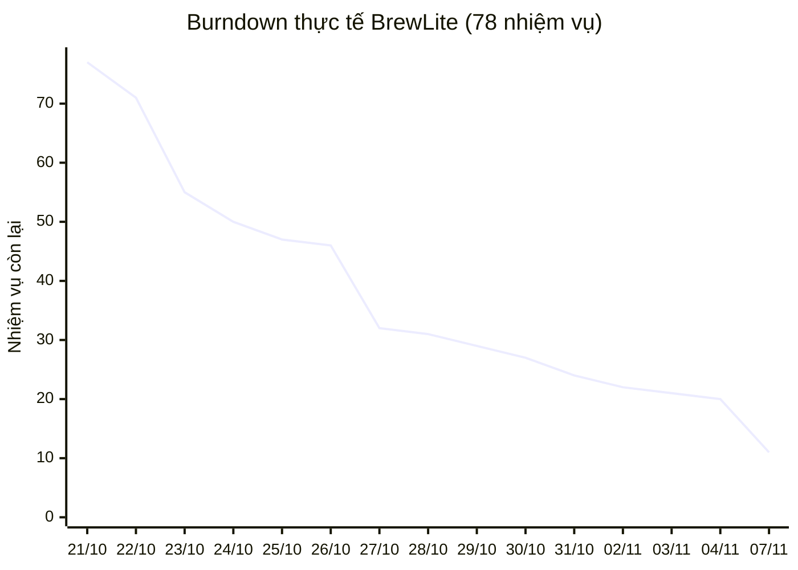

# BrewLite - Sprint Retrospective (Sprint 3, bàn giao)

**Trạng thái:** bản nháp. Nhóm hoàn thiện các ô trống trong buổi Retrospective.  
**Ngày họp:** ……/……/2026  
**Người điều phối:** H.Tài (Scrum Master)  
**Thành viên tham dự:** ☐ H.Tài ☐ Nghĩa ☐ Luân ☐ P.Tài ☐ Bảo Trí  
**Liên quan:** [Working agreement §2.3](../working-agreement.md), [Kịch bản demo](../demo-script.md), [Kế hoạch Sprint](../diagrams/sprint-plan.md), [Checklist đề bài](../brewlite-checklist.md), Retro [Sprint 1](retro-sprint-1.md), [Sprint 2](retro-sprint-2.md), đề Assignment 1 §10–§11

Theo working agreement, buổi Retrospective dài 20 phút, diễn ra sau Sprint Review và phải chốt **một hành động cải tiến**. Mục 11 của đề yêu cầu trình bày "điều làm tốt, điều cần cải thiện".

Phần **"Dữ kiện"** lấy từ file danh sách task (`BrewLite-DanhSachTask`), lịch sử Git trên `main` và GitHub (số liệu ngày 10/11/2026). Phần **"Ý kiến thành viên"** do từng người tự điền, không ai điền thay.

## 1. Kết quả Sprint 3

**Sprint Goal:** Thanh toán, bàn giao và nghiệp vụ nâng cao (Task 8, 9, 10).

| Task / hạng mục | Nội dung                                   | Trạng thái | Bằng chứng chính                                                                                      |
| --------------- | ------------------------------------------ | ---------- | ----------------------------------------------------------------------------------------------------- |
| Task 8          | Thanh toán không tiền mặt (mock Ví/Thẻ)    | Xong       | `POST /payments`; `test/payments.e2e-spec.ts`; trang checkout                                          |
| Task 9          | Xác nhận, lịch sử đơn, bàn giao            | Xong       | `/orders/[id]/confirmation`, `GET /orders/me`, `docker-compose.yml`, README                            |
| Task 10         | State machine, idempotent, tồn kho, khuyến mãi, điểm | Xong | `order-state-machine.spec.ts`, `payments.e2e-spec.ts`, `orders-concurrent-stock.e2e-spec.ts`; state machine sửa đúng sơ đồ §9.1 (PR #12) |
| Mở rộng         | Trang Admin: tồn kho món/topping, giá topping, khoá tài khoản, huỷ mã | Xong | PR #14, #15; `test/admin-stock.e2e-spec.ts`, `test/admin-management.e2e-spec.ts` |
| Bàn giao        | Kịch bản demo, README, retro 3 sprint      | Bản nháp   | `docs/demo-script.md`, `README.md`, `docs/plans/retro-sprint-*.md`                                     |

### 1.1 Kiểm tra Definition of Done cho cả 10 task (đề §10)

Theo tiêu chí chấp nhận của Task 9 trong backlog, bảng này phải được kiểm tra cho cả 10 task. Các ô đã điền sẵn theo bằng chứng trong repo; nhóm xác nhận lại trong buổi họp. "—" là tiêu chí không áp dụng cho task đó (ví dụ task chỉ có giao diện thì không có API để validate).

| Task | Chạy được, đạt tiêu chí | Commit rõ ràng | Được review trong nhóm | API validate đầu vào | UI xử lý loading/lỗi | Có hướng dẫn trong README |
| ---- | ----------------------- | -------------- | ---------------------- | -------------------- | -------------------- | ------------------------- |
| 1    | ✅ chạy được web, API   | ✅             | ❌                     | —                    | —                    | ✅                        |
| 2    | ✅ unit + e2e products  | ✅             | ❌                     | ✅ id sai → 404       | —                    | ✅                        |
| 3    | ✅                      | ✅             | ❌                     | —                    | ✅ skeleton, trống, lỗi | ✅                     |
| 4    | ✅                      | ✅             | ❌                     | —                    | ✅                   | ✅                        |
| 5    | ✅                      | ✅             | ❌                     | ✅ `PUT /cart`        | ✅                   | ✅                        |
| 6    | ✅ e2e orders           | ✅             | ❌                     | ✅ class-validator    | —                    | ✅                        |
| 7    | ✅ e2e auth             | ✅             | ❌                     | ✅                    | ✅                   | ✅                        |
| 8    | ✅ e2e payments         | ✅             | ❌                     | ✅                    | ✅                   | ✅                        |
| 9    | ✅ docker-compose chạy đủ 3 dịch vụ | ✅ | ❌                     | ✅                    | ✅                   | ✅                        |
| 10   | ✅ 3 bài test chấm điểm đạt | ✅         | ❌                     | ✅                    | —                    | ✅                        |

Cột "Được review trong nhóm" là ❌ vì cả **11 Pull Request đã merge** (#1, #3, #4, #6, #7, #10–#15) đều **0 lượt review** trên GitHub. Một số commit cũ có mô tả chưa rõ (ví dụ "missing commit", "fix ui mobile"), nhưng phần lớn theo Conventional Commits.

### 1.2 Burndown thực tế (toàn dự án)

Số nhiệm vụ còn lại sau mỗi ngày, tính từ cột "Ngày" hoàn thành mà nhóm ghi trong file danh sách task (78 nhiệm vụ). Đây là số liệu nhóm tự ghi, chưa đối chiếu từng dòng với Git. Burndown theo story points của từng sprint nằm ở [sprint-plan.md §4](../diagrams/sprint-plan.md).

| Ngày          | 21/10 | 22/10 | 23/10 | 24/10 | 25/10 | 26/10 | 27/10 | 28/10 | 29/10 | 30/10 | 31/10 | 02/11 | 03/11 | 04/11 | 07/11 |
| ------------- | ----- | ----- | ----- | ----- | ----- | ----- | ----- | ----- | ----- | ----- | ----- | ----- | ----- | ----- | ----- |
| Xong trong ngày | 1   | 6     | 16    | 5     | 3     | 1     | 14    | 1     | 2     | 2     | 3     | 2     | 1     | 1     | 9     |
| Còn lại       | 77    | 71    | 55    | 50    | 47    | 46    | 32    | 31    | 29    | 27    | 24    | 22    | 21    | 20    | 11    |

File task chưa ghi các việc đã xong sau 07/11: #78 (PR #12, #13 merge 08/11) và phần admin mở rộng (PR #14, #15 merge 09/11).

### 1.3 Kết quả chạy thử demo

| Ngày       | Môi trường                                  | Kết quả |
| ---------- | ------------------------------------------- | ------- |
| 08/11/2026 | `docker compose` (db, api, web), máy 8 GB RAM | Đạt (gọi API). Menu 30 món → đăng nhập → tạo đơn có mã `WELCOME20K` → thanh toán Ví `PAID` → gửi lại cùng `Idempotency-Key` không tạo thanh toán mới → xác nhận đơn và điểm tích luỹ → khách tự đổi trạng thái đơn bị chặn (403) → các trang web trả về 200 |
| 09/11/2026 | Chạy trên máy (nhánh PR #14, #15)            | Đạt (gọi API và chụp màn hình). Tồn kho topping trừ khi thanh toán, thiếu topping bị từ chối, khoá tài khoản chặn đăng nhập và token cũ, mã bị huỷ bị từ chối, giá topping mới áp dụng cho đơn mới |
|            | Chạy đủ kịch bản trên giao diện (nhóm điền)  |         |

## 2. Điều làm tốt

### Dữ kiện

- **Đủ 10/10 task của đề có code và test.** Toàn bộ test đạt: API unit 120, API e2e 86 (gồm 3 bài test chấm Task 10), web 114 (chạy lại trên `main` ngày 10/11).
- **Tài liệu chuẩn bị từ sớm:** product backlog có tiêu chí chấp nhận, kịch bản (`scenarios.md`), 5 ADR, API contract, wireframe 5 màn hình, kế hoạch 3 Sprint, checklist đối chiếu đề bài.
- **Nghiệp vụ tách riêng và có test:** state machine, tính giá, khuyến mãi, điểm tích luỹ và tính phần topping nằm trong các module riêng có unit test.
- **Bàn giao chạy được bằng một lệnh:** `docker compose` dựng đủ 3 dịch vụ (mục 1.3).
- **Lỗi được phát hiện và sửa trước khi bàn giao:**
  - State machine lệch sơ đồ §9.1, khách tự đổi được trạng thái đơn, trang admin bỏ qua state machine (PR #12).
  - Nút "Thanh toán" chưa hiện tổng tiền theo US-05 (PR #13).
  - Thanh toán không trừ tồn kho topping, topping hết vẫn bán được (PR #14).
  - Tiêu đề tiếng Việt bị lỗi font (PR #15).
  - Mười lỗi frontend, gồm chuyển hướng không an toàn sau đăng nhập và trang xác nhận đơn (PR #10).

### Ý kiến thành viên

| Thành viên | Điều làm tốt |
| ---------- | ------------ |
| H.Tài      |              |
| Nghĩa      |              |
| Luân       |              |
| P.Tài      |              |
| Bảo Trí    |              |

## 3. Điều cần cải thiện

### Dữ kiện

- **Review chưa đúng quy trình:** working agreement §1 quy định "không ai tự merge PR của mình" và mọi thay đổi phải qua PR có review. Thực tế 11 PR đã merge đều 0 lượt review; nhiều PR được tự merge ngay sau khi tạo (PR #15 merge 17 giây sau khi mở). Ngoài ra nhiều thay đổi được push thẳng vào `main` không qua PR.
- **Hiểu sai đề và phát hiện muộn:** ADR 0004 đọc sai sơ đồ trạng thái §9.1 (thử lại thanh toán và huỷ đơn đã thanh toán). Lỗi đến 08/11 mới được phát hiện và sửa.
- **Ranh giới sprint không được giữ:** file task ghi "Phase sau chỉ bắt đầu khi Phase trước hoàn tất", nhưng theo ngày hoàn thành ghi trong file, phần lớn task của cả 3 sprint xong trong cùng khoảng 23/10–02/11 (ví dụ 9/12 việc của Sprint 3B ghi xong ngày 23/10, cùng ngày với các việc khởi tạo dự án của Sprint 1).
- **Khối lượng dồn theo đợt:** số commit trên `main` theo giai đoạn (126 commit, không tính commit merge):

  | Giai đoạn     | Số commit | Theo tài khoản Git |
  | ------------- | --------- | ------------------ |
  | Đến 22/10     | 37        | TaiHo 19, Nghiaphan123 17, undertaker-rpl 1 |
  | 23/10–27/10   | 35        | TaiHo 21, undertaker-rpl 6, Baotris-23 5, Nghiaphan123 3 |
  | 28/10–03/11   | 19        | Baotris-23 9, TaiHo 4, Nghiaphan123 4, undertaker-rpl 2 |
  | 04/11–10/11   | 35        | Nguyen Phu Tai 31, Nghiaphan123 3, TaiHo 1 |

- **Nhánh sống lâu, merge qua lại:** `dev2` và `dev3` được merge qua lại với `main` nhiều lần, gây xung đột. Nhánh `dev3` (kiểm tra dữ liệu trang đăng nhập) vẫn còn 2 commit chưa quyết định gộp hay bỏ.
- **Docker:** image chứa toàn bộ `node_modules`, kể cả công cụ phát triển, nên build lần đầu mất khoảng 80 phút trên máy 8 GB RAM. Image cũ không tự cập nhật sau `git pull`, phải chạy `docker compose up --build -d`.
- **Tài liệu theo dõi chưa cập nhật kịp:**
  - Traceability matrix vẫn ghi `TBD` ở mọi dòng.
  - Burndown trong kế hoạch Sprint là biểu đồ mẫu cho tới ngày 10/11, không được cập nhật hằng ngày trong lúc làm (nay đã thay bằng số liệu thật, xem [sprint-plan.md §4](../diagrams/sprint-plan.md)).
  - Biên bản retro Sprint 1 và 2 không được viết lúc kết thúc sprint (đã lập bổ sung).
  - File task chưa ghi các việc xong sau 07/11, và một số dòng ghi chưa đúng ngày, người làm.
- **Yêu cầu phi chức năng chưa kiểm chứng:** đến ngày 10/11 chưa đo "API phản hồi dưới 500 ms" (đã đo bổ sung ngày 15/11, đạt: `docs/testing/nfr-response-time.md`); chưa thử trên nhiều trình duyệt (đề §4.2).

### Ý kiến thành viên

| Thành viên | Điều cần cải thiện |
| ---------- | ------------------ |
| H.Tài      |                    |
| Nghĩa      |                    |
| Luân       |                    |
| P.Tài      |                    |
| Bảo Trí    |                    |

## 4. Hành động cải tiến

Working agreement yêu cầu chốt **một** hành động chính. Các đề xuất để nhóm bàn:

| #   | Đề xuất                                                                                             | Giải quyết vấn đề                 |
| --- | --------------------------------------------------------------------------------------------------- | --------------------------------- |
| A   | Bật branch protection cho `main`: bắt buộc qua PR và có ít nhất 1 approve trước khi merge          | Review chưa đúng quy trình        |
| B   | Mỗi ADR hoặc tài liệu đọc từ đề phải có một người khác đối chiếu lại với PDF trước khi chốt        | Hiểu sai đề                       |
| C   | Nhánh ngắn theo từng việc (`feat/...`, `fix/...`), merge vào `main` trong vòng 2–3 ngày             | Nhánh sống lâu, dồn việc theo đợt |
| D   | Cập nhật file task và burndown cuối mỗi ngày làm việc, theo PR đã merge                             | Tài liệu theo dõi chưa cập nhật   |

**Hành động được chọn:** ………………………………  
**Người phụ trách:** ………………  
**Kiểm tra lại vào:** ………………

## 5. Phản hồi của khách hàng và backlog phiên bản sau (đề §11, mục 4)

### 5.1 Phản hồi của giảng viên trong buổi demo

| #   | Phản hồi | Ưu tiên | Đưa vào backlog |
| --- | -------- | ------- | --------------- |
| 1   |          |         |                 |
| 2   |          |         |                 |

### 5.2 Việc tồn đọng nhóm đã biết

| Việc                                                                                       | Ghi chú                                       |
| ------------------------------------------------------------------------------------------ | --------------------------------------------- |
| Chuyển về trang đăng nhập khi chưa đăng nhập ở `/menu`, `/orders`, `/orders/[id]`          | Hiện chỉ `/cart`, `/checkout` có chặn         |
| Gộp hai trang trùng chức năng `/account` và `/profile`                                     |                                               |
| Giao diện nhận diện admin theo vai trò (`role`) thay vì theo email `admin@…`               | API đã kiểm tra quyền thật                    |
| Thêm ô "Nhập lại mật khẩu" khi đăng ký                                                     | Wireframe màn 7 có ô này                      |
| `PAYMENT_MOCK_MODE=random` được nhắc trong `config.md`, ADR 0004 nhưng code chỉ hiểu `success`/`failure` | Sửa tài liệu hoặc code              |
| Thử trên Chrome, Edge, Firefox, điện thoại (đo < 500 ms đã xong 15/11)                     | Task #66 (#65 xong); đề §4.2                  |
| Cập nhật burndown thật vào `docs/diagrams/sprint-plan.md`                                  | Task #67; số liệu ở mục 1.2                   |
| Làm nhẹ Dockerfile (chỉ cài thư viện cần cho lúc chạy)                                    | Giảm thời gian build và dung lượng            |
| Quyết định nhánh `dev3`                                                                    | Xung đột với bản sửa trang đăng nhập ở PR #10 |
| Ghi chú vì sao dùng `@nestjs/jwt` thay vì Passport                                         | Theo checklist đề bài                         |
