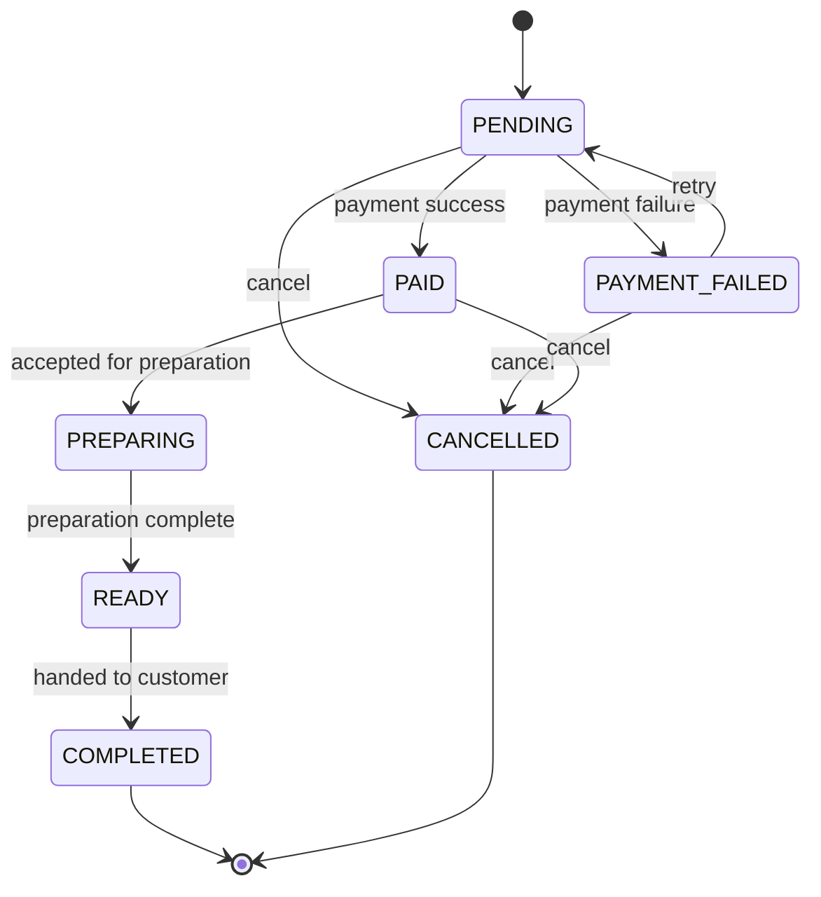

# BrewLite - Software Requirements Specification

**Version:** 0.2  
**Status:** Draft for team review (task D-04)  
**Replaces:** the earlier `requirements.md` baseline (IDs FR-01 to FR-12 and NFR-01 to NFR-07 are kept stable)  
**Related:** [Context and scope](context-and-scope.md), [Use-case overview](../diagrams/use-case-overview.md), [UC-01 spec](use-case-uc01-place-and-pay.md), [Plans overview](../plans/00-overview.md)  
**Sources:** Assignment 1 (sections 4, 8, 9, 12) and Assignment 2 (Task 1.2)

Items marked **(proposed)** are the team's own additions. Items marked **(pending D-01)** depend on the decision meeting; see the [decision checklist](../plans/01-documentation-plan.md#3-decision-checklist-d-01).

## 1. Purpose and scope

This document lists what BrewLite must do and how well, with testable acceptance criteria and a MoSCoW priority for every requirement. Background, stakeholders, assumptions, constraints, and risks are in [context-and-scope.md](context-and-scope.md).

BrewLite lets a customer browse a sample drink menu, customize a drink, build a cart, sign in, place an order, pay through a simulated Wallet or Card gateway, and view the result and order history. Barista screens and real payment providers are out of scope.

## 2. Priority scale (MoSCoW)

| Level  | Meaning                                                      |
| ------ | ------------------------------------------------------------ |
| Must   | Required by the assignments; the delivery fails without it   |
| Should | Important and planned, but delivery does not fail without it |
| Could  | Optional; done only if time allows                           |
| Won't  | Deliberately not built in this release                       |

## 3. Functional requirements

The **Use case** column links to the [use-case overview](../diagrams/use-case-overview.md).

| ID    | Requirement                     | Acceptance criteria                                                                                                                                                                                                                                                                                      | Priority | Use case     | Source                                                     |
| ----- | ------------------------------- | -------------------------------------------------------------------------------------------------------------------------------------------------------------------------------------------------------------------------------------------------------------------------------------------------------- | -------- | ------------ | ---------------------------------------------------------- |
| FR-01 | Browse drinks                   | `GET /products` returns 200 with a list; each item has `id`, `name`, `price`, `imageUrl`. The menu page shows the items, a loading state while fetching, an empty message when the list is empty, and an error message when the request fails.                                                           | Must     | UC-02        | A1 s4.1, Task 2, 3                                         |
| FR-02 | View and customize a drink      | `GET /products/:id` returns the product, or 404 for an unknown id. The detail page offers size S, M, L and the available toppings, and the shown price updates with each choice according to the pricing rule (pending D-01).                                                                            | Must     | UC-03        | A1 s4.1, Task 4                                            |
| FR-03 | Manage cart                     | The customer can add an item, change its quantity, and remove it. The badge shows the total item count and the total price recalculates after every change.                                                                                                                                              | Must     | UC-04        | A1 s4.1, Task 5                                            |
| FR-04 | Register and sign in            | `POST /auth/register` creates an account and stores only a bcrypt hash; a duplicate email is rejected. `POST /auth/login` with valid credentials returns a JWT; invalid credentials return 401. No response contains the password or its hash.                                                           | Must     | UC-05        | A1 s4.1, Task 7                                            |
| FR-05 | Create order                    | An authenticated customer submits the cart to `POST /orders`. Invalid input returns 400; a missing or invalid JWT returns 401. The server recalculates prices and totals and ignores any client-sent totals. A valid order is saved as `PENDING`, stock is held, and the response includes the order ID. | Must     | UC-01        | A1 Task 6                                                  |
| FR-06 | Pay without cash                | The customer chooses Wallet or Card and calls `POST /payments` with the order ID, method, and an `Idempotency-Key`. Success moves the order to `PAID`; failure moves it to `PAYMENT_FAILED` and the cart contents stay available for retry. Only the order's owner can pay; a missing key returns 400.   | Must     | UC-01        | A1 US-05, Task 8                                           |
| FR-07 | Confirm order                   | After a successful payment the UI shows the order ID and the status `PAID`.                                                                                                                                                                                                                              | Must     | UC-01        | A1 US-05, Task 9                                           |
| FR-08 | View order history              | `GET /orders/me` returns only the signed-in customer's orders with ID, status, total, and creation time; it returns 401 without a JWT.                                                                                                                                                                   | Must     | UC-06        | A1 Task 9                                                  |
| FR-09 | Enforce order state machine     | Valid transitions are exactly those in section 5. Any other transition is rejected with an error and leaves the order unchanged. `COMPLETED` and `CANCELLED` are terminal.                                                                                                                               | Must     | UC-01, UC-07 | A1 Task 10                                                 |
| FR-10 | Make payment idempotent         | Two payment requests with the same `Idempotency-Key` from the same user produce one payment and one order effect; the second returns the recorded outcome. The database enforces key uniqueness.                                                                                                         | Must     | UC-01        | A1 Task 10                                                 |
| FR-11 | Protect stock under concurrency | Concurrent orders cannot make stock negative. Stock is updated in a database transaction with optimistic locking. Stock is held when the order is created and released exactly once when the order becomes `CANCELLED`.                                                                                  | Must     | UC-01        | A1 Task 10                                                 |
| FR-12 | Apply promotion and loyalty     | A valid promotion changes the order total as defined by the rule (pending D-01); an invalid or expired code is rejected. After the order is `PAID`, loyalty points are credited once per order.                                                                                                          | Must     | UC-01        | A1 Task 10                                                 |
| FR-13 | View a single order status      | `GET /orders/:id` returns the order and its current status to its owner and rejects other users.                                                                                                                                                                                                         | Should   | UC-06        | A2 s1.1 "track order" **(proposed)**                       |
| FR-14 | Update order status internally  | A restricted internal operation moves a paid order through `PREPARING`, `READY`, and `COMPLETED` so the state machine can be demonstrated without a barista screen. It rejects illegal transitions.                                                                                                      | Should   | UC-07        | A1 s9 **(proposed)**                                       |
| FR-15 | Cancel an order                 | An order can be cancelled from `PENDING`, `PAYMENT_FAILED`, or `PAID` and releases held stock once. Who may trigger it and how a `PAID` refund is recorded are pending D-01.                                                                                                                             | Could    | UC-08        | A1 s9.1 diagram                                            |
| FR-16 | Expire unpaid orders            | A `PAYMENT_FAILED` order not paid within a set window is cancelled automatically and its stock released (window pending D-01).                                                                                                                                                                           | Could    | -            | **(proposed)**                                             |
| FR-17 | Temporary QR payment demo       | Checkout can show a bank QR for the order total and order code, with a demo-only control that simulates "payment received" through the same confirmation path as the mock gateway.                                                                                                                       | Could    | UC-01        | [Payment plan](../plans/05-payment-plan.md) **(proposed)** |
| FR-18 | Sandbox payment gateway         | Payment can run through a real provider's sandbox using test money.                                                                                                                                                                                                                                      | Could    | UC-01        | [Payment plan](../plans/05-payment-plan.md) **(proposed)** |

### 3.1 Won't have (this release)

| ID    | Item                                                       | Reason                                        |
| ----- | ---------------------------------------------------------- | --------------------------------------------- |
| WN-01 | Barista screen to accept and update orders                 | Extension; outside the MVP                    |
| WN-02 | Real payment provider with real money                      | Out of scope; payment is simulated            |
| WN-03 | Automatic detection of real bank transfers                 | Needs bank integration and real money         |
| WN-04 | Admin or menu-management screen **(proposed)**             | Not needed for the customer flow              |
| WN-05 | Multiple stores, delivery, or table service **(proposed)** | Beyond one counter                            |
| WN-06 | Email or push notifications **(proposed)**                 | Not required                                  |
| WN-07 | Native mobile apps **(proposed)**                          | The product is a mobile-first web app and PWA |

## 4. Non-functional requirements

| ID     | Category         | Requirement                                                                                                                                                               | Acceptance measure                                                                   | Priority | Source                  |
| ------ | ---------------- | ------------------------------------------------------------------------------------------------------------------------------------------------------------------------- | ------------------------------------------------------------------------------------ | -------- | ----------------------- |
| NFR-01 | Performance      | API response time is under 500 ms with sample data.                                                                                                                       | Timed run with a documented sample size, request mix, and environment (pending D-01) | Must     | A1 s4.2                 |
| NFR-02 | Security         | Passwords are stored only as bcrypt hashes.                                                                                                                               | Database check shows a hash, never plaintext                                         | Must     | A1 s4.2                 |
| NFR-03 | Security         | JWT protects order creation, payment, and user-specific history.                                                                                                          | Unauthenticated calls return 401; another user's data is not readable                | Must     | A1 s4.2                 |
| NFR-04 | Security         | All API inputs are validated and invalid data is rejected with a client error.                                                                                            | Invalid-input tests on every write endpoint return 4xx                               | Must     | A1 s4.2                 |
| NFR-05 | Compatibility    | The web app works on current mainstream browsers.                                                                                                                         | Smoke test on an agreed browser and version list (pending D-01)                      | Must     | A1 s4.2                 |
| NFR-06 | Run and handover | Docker Compose runs the frontend, backend, and database; the README explains setup and demo.                                                                              | A teammate follows the README from a clean clone                                     | Must     | A1 s11                  |
| NFR-07 | Resilience       | Loading, empty, and basic error states are handled wherever data is fetched.                                                                                              | UI checks on menu, checkout, and history                                             | Must     | A1 s10                  |
| NFR-08 | Mobile and PWA   | The UI is mobile-first and installable as a PWA.                                                                                                                          | Layout works on a phone-sized viewport; a web manifest is present                    | Must     | A2 s1.1                 |
| NFR-09 | Operability      | The API exposes `GET /health` and writes request and error logs.                                                                                                          | Health check returns OK and is used by Compose and the deploy smoke test             | Must     | A2 Task 3.1, 5.2        |
| NFR-10 | Quality gate     | CI runs install, lint, unit test, and build on every pull request, and a failing run blocks the merge.                                                                    | One passing and one failing pipeline run are recorded                                | Must     | A2 Task 4.4             |
| NFR-11 | Deployability    | The system runs on a public HTTPS URL, the production database is not public, and no secret is in the repository or CI logs.                                              | Production URLs reachable at grading; secrets audit                                  | Must     | A2 Task 5.4             |
| NFR-12 | Repeatability    | Migrations and seed data recreate the database from scratch.                                                                                                              | A fresh database is built and seeded by documented commands                          | Must     | A2 Task 5.2             |
| NFR-13 | Verifiability    | Required tests exist: illegal transitions rejected, duplicate key gives one effect, concurrent orders do not oversell, plus an end-to-end test from menu to confirmation. | Tests listed in the [testing plan](../plans/04-testing-plan.md) pass                 | Must     | A1 Task 10, A2 Task 5.2 |
| NFR-14 | Usability        | A customer can go from choosing a drink to a payment confirmation through the five wireframe screens: menu, detail, cart, payment, confirmation.                          | Walk-through of the demo flow **(proposed)**                                         | Should   | A1 s7                   |
| NFR-15 | Accessibility    | Interactive controls have visible labels and keyboard focus.                                                                                                              | Manual check on main pages **(proposed)**                                            | Could    | -                       |

## 5. Order state machine

Any transition not shown is rejected. This matches the Assignment 1 state diagram. `CANCELLED` is reachable only from `PENDING`, `PAYMENT_FAILED`, and `PAID`.

## 6. Business rules and data

### 6.1 Rules

- Order creation starts at `PENDING`.
- A successful payment moves the order to `PAID`; a failed attempt moves it to `PAYMENT_FAILED`, and a retry moves it back to `PENDING` before the next attempt.
- The same idempotency key must not cause duplicate payment effects. A payment retry after a failure uses a new key; resending the same key returns the recorded outcome **(proposed)**.
- Stock must never become negative. It is held when an order is created, stays held through `PAYMENT_FAILED`, and is released exactly once when the order becomes `CANCELLED`.
- Loyalty points are credited after an order is `PAID`, at most once per order.
- The server recalculates prices and totals from product and option data; client totals are never trusted.
- A user can read and pay only their own orders.

### 6.2 Entities

Minimum entities from Assignment 1, with proposed additions marked:

| Entity                          | Fields                                                                                            |
| ------------------------------- | ------------------------------------------------------------------------------------------------- |
| `Product`                       | `id`, `name`, `price`, `imageUrl`, `stock`                                                        |
| `User`                          | `id`, `email`, `passwordHash`, `loyaltyPoints`                                                    |
| `Order`                         | `id`, `userId`, `status`, `total`, `createdAt`; proposed: promotion reference and discount amount |
| `OrderItem`                     | `id`, `orderId`, `productId`, `size`, `qty`, `lineTotal`; proposed: selected toppings             |
| `Payment`                       | `id`, `orderId`, `idempotencyKey`, `amount`, `method`; proposed: outcome and timestamp            |
| `Promotion` (proposed)          | `id`, `code`, discount type and value, validity period, active flag                               |
| `LoyaltyTransaction` (proposed) | `id`, `userId`, `orderId`, `points`, `createdAt`; unique per order                                |

Exact fields and relationships are finalized in the class diagram (D-09).

## 7. API baseline

| Method                           | Path             | Purpose                                                 | Access           | Priority |
| -------------------------------- | ---------------- | ------------------------------------------------------- | ---------------- | -------- |
| GET                              | `/products`      | List menu products                                      | Public           | Must     |
| GET                              | `/products/:id`  | Product details                                         | Public           | Must     |
| POST                             | `/auth/register` | Register user                                           | Public           | Must     |
| POST                             | `/auth/login`    | Sign in and issue JWT                                   | Public           | Must     |
| POST                             | `/orders`        | Create `PENDING` order from cart                        | JWT              | Must     |
| POST                             | `/payments`      | Pay or retry; needs `Idempotency-Key`                   | JWT, order owner | Must     |
| GET                              | `/orders/me`     | List the current user's orders                          | JWT              | Must     |
| GET                              | `/health`        | Health check **(proposed)**                             | Public           | Must     |
| GET                              | `/orders/:id`    | One order, owner only **(proposed)**                    | JWT, owner       | Should   |
| PATCH (internal, path to decide) | to decide        | Move an order through preparation states **(proposed)** | Restricted       | Should   |

## 8. Verification and Definition of Done

A requirement is done when its code runs, meets its acceptance criteria, has a clear commit and a peer review, validates API input, handles loading and error states where relevant, and has run instructions in the README. The test for each requirement is listed in the [testing plan](../plans/04-testing-plan.md#4-requirement-to-test-map).

## 9. Open decisions

These stay open until the decision meeting (D-01). The relevant rows above change when they are settled.

1. Pricing rule for sizes and toppings (FR-02, FR-05).
2. Promotion eligibility, discount type, and loyalty points formula (FR-12).
3. Who may cancel, refund handling for a cancelled `PAID` order, and the retry-expiry window (FR-15, FR-16).
4. Stock unit: finished drinks or ingredients (FR-11).
5. Performance test method and browser support list (NFR-01, NFR-05).
6. Payment approach for the temporary QR demo and the optional sandbox (FR-17, FR-18).