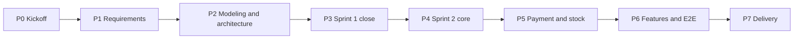

# BrewLite - Plan Overview

**Version:** 1.0  
**Status:** Draft for team review  
**Location:** `docs/plans/`  
**Sources:** Assignment 1 (`BrewLite-CongNghePhanMem.pdf`) and Assignment 2 (`Assignment2-BrewLite.pdf`)

This is the entry point to the BrewLite plan set. It explains how to read the plans, lists the phases and their exit gates, and links to the detailed plan for each work category. Read this file first, then open the category plan you own work in.

## 1. The plan set

| Document                                               | What it holds                                                                                                     | ID prefix         |
| ------------------------------------------------------ | ----------------------------------------------------------------------------------------------------------------- | ----------------- |
| [00-overview.md](00-overview.md) (this file)           | How to read the plans, phases, gates, rules, coverage maps                                                        | -                 |
| [01-documentation-plan.md](01-documentation-plan.md)   | Documentation and analysis tasks: requirements, diagrams, architecture, ADRs, traceability, README, handover docs | `D-`              |
| [02-setup-devops-plan.md](02-setup-devops-plan.md)     | Repository, board, tooling, Docker Compose, CI, CD, production deployment                                         | `S-`              |
| [03-implementation-plan.md](03-implementation-plan.md) | Code tasks in `apps/api` and `apps/web`                                                                           | `C-`              |
| [04-testing-plan.md](04-testing-plan.md)               | Test strategy and test tasks in `apps/*` and `tests/`                                                             | `T-`              |
| [05-payment-plan.md](05-payment-plan.md)               | Payment approach, provider options, and the related tasks                                                         | (uses `C-`, `T-`) |

Each plan holds the authoritative detail for its own tasks. This overview does not repeat task descriptions; it only shows how tasks fit together.

## 2. How to read a plan

### 2.1 Work item IDs

Every task has one ID: a category letter and a number, for example `C-06`. Use the ID in issue titles, branch names, commit messages, and pull requests.

- `D-` documentation and analysis
- `S-` setup and DevOps
- `C-` code
- `T-` testing

Assignment tasks are written **A1-Tn** (Assignment 1, tasks 1 to 10) and **A2-Tn** (Assignment 2, tasks 1 to 5). The assignments both say "Task 1", so always include the prefix.

### 2.2 Task table columns

| Column   | Meaning                                                               |
| -------- | --------------------------------------------------------------------- |
| ID       | Work item ID                                                          |
| Task     | What to do                                                            |
| Output   | The file, endpoint, or evidence that proves it is done                |
| Phase    | The phase it belongs to (see section 3)                               |
| Needs    | Task IDs that must be **Done** before this task can start or finish   |
| Priority | **Must** (required by an assignment) or **Could** (optional, stretch) |
| Owner    | Filled in by the team lead                                            |
| Status   | `Todo`, `In progress`, `Review`, or `Done`                            |

### 2.3 Reading dependencies

- **Needs** is a hard dependency. A task is ready only when everything in its Needs column is `Done`.
- Two tasks in the same phase with no Needs link between them can be done in parallel.
- A note such as "can start with mocked data" means work may begin early but cannot merge until the dependency is `Done`.
- Tasks do not need to be equal in size. Phases are groups of work that can run side by side, not equal workloads.

### 2.4 Phase and Sprint

A **phase** is a group of tasks that can run in parallel and share one exit gate. Phases map onto the Scrum sprints from the assignments (section 3). Move to the next phase only when the current exit gate is met.

## 3. Phases

| Phase                            | Sprint   | Documentation                                 | Setup            | Code                               | Testing                | Exit gate                                                   |
| -------------------------------- | -------- | --------------------------------------------- | ---------------- | ---------------------------------- | ---------------------- | ----------------------------------------------------------- |
| **P0** Kickoff                   | -        | D-01, D-16 (skeleton)                         | S-01, S-02       | -                                  | -                      | Decisions logged; repo and board ready                      |
| **P1** Requirements              | Sprint 1 | D-02, D-03, D-04, D-05, D-06                  | S-03             | C-01, C-02                         | -                      | SRS and use-case spec merged; both apps run "Hello"         |
| **P2** Modeling and architecture | Sprint 1 | D-07, D-08, D-09, D-10, D-11, D-14 (skeleton) | S-04             | C-03                               | T-01                   | Diagrams and ADRs merged; DB schema migrates and seeds      |
| **P3** Sprint 1 close            | Sprint 1 | D-12, D-13                                    | S-05             | C-04, C-09, C-14                   | T-02, T-03, T-05       | Menu MVP runs; CI green; A2 Tasks 1 to 4 artifacts complete |
| **P4** Sprint 2 core             | Sprint 2 | -                                             | S-06             | C-05, C-06, C-13, C-15, C-16, C-17 | -                      | Sign-in, order creation, and cart work                      |
| **P5** Payment and stock         | Sprint 2 | -                                             | -                | C-07, C-08, C-10, C-11             | T-04, T-06, T-07, T-12 | Payment is idempotent; stock is safe under concurrency      |
| **P6** Features and E2E          | Sprint 2 | -                                             | -                | C-12, C-18, C-19, C-20, C-21       | T-08, T-09             | Full flow passes E2E locally through Docker Compose         |
| **P7** Delivery                  | Delivery | D-14 (final), D-15, D-16 (final), D-18        | S-07, S-08, S-09 | C-22                               | T-10, T-11             | Production URL live; handover complete                      |

`D-17` (Scrum artifacts) runs from P1 to P7 and is not tied to one phase.

### 3.1 Critical path

The longest dependency chain, which most affects the schedule:

`D-01` -> `D-03` -> `D-04` -> `D-06` -> `D-08`, and in parallel `C-03` -> `C-06` -> `C-07` -> `C-10` -> `C-18` -> `T-09` -> `S-07` -> `S-08`.

Delay on any of these delays delivery. `D-01` (the decision meeting) is the single biggest unblocker; do it first.

### 3.2 Phase notes

- **P0:** Only `S-01` and `D-01` can start immediately. `S-02` and `D-16` follow `S-01`.
- **P1 to P3:** Documentation and code scaffolding run side by side. Documentation is the gate (see rule 1 below).
- **P4 to P6:** Backend and frontend lanes run mostly in parallel; the frontend can begin on mocked API responses.
- **P7:** Deployment depends on every code and test task being finished.

## 4. Working rules

1. **Artifacts before acceptance.** Assignment 2 accepts a later task only when the required artifacts of the earlier task are in the repository with clear history. Code for Sprint 1 may be developed in P1 and P2 on branches, but merge documentation pull requests for A2 Tasks 1 to 3 into `main` first.
2. **Task before commit.** Every branch, commit, and pull request names its work item ID, for example `feat/C-06-create-order` and `C-06: validate order DTO`.
3. **Ready and done.** A task starts when its Needs are `Done`. It is `Done` when it meets the Definition of Done below.
4. **Changes go through pull requests.** Any change to requirements, diagrams, or architecture needs a pull request with a stated reason (Assignment 2, Task 4.2).
5. **Quality gate.** A pull request cannot merge if lint, test, or build fails (Assignment 2, Task 4.4).

### 4.1 Definition of Done (Assignment 1, section 10)

- Code runs without build errors and meets the task's acceptance criteria.
- Clear Git commit with a descriptive message; reviewed by a teammate.
- API validates input; UI handles basic loading and error states.
- Run instructions are in the README.

## 5. Coverage maps

### 5.1 Assignment 1 tasks

| Assignment task                       | Work items                                                |
| ------------------------------------- | --------------------------------------------------------- |
| A1-T1 Project setup                   | S-01, S-03, C-01, C-02, D-16                              |
| A1-T2 Products API                    | C-04                                                      |
| A1-T3 Menu page                       | C-14                                                      |
| A1-T4 Product detail and options      | C-15                                                      |
| A1-T5 Cart                            | C-16                                                      |
| A1-T6 Create order API                | C-06                                                      |
| A1-T7 Register and login              | C-05, C-17                                                |
| A1-T8 Cashless payment                | C-07, C-18, plan [05-payment-plan.md](05-payment-plan.md) |
| A1-T9 Confirmation, history, handover | C-08, C-19, S-04, D-16, D-18                              |
| A1-T10 Backend business rules         | C-09, C-10, C-11, C-12, T-05, T-06, T-07, T-08            |

### 5.2 Assignment 2 tasks

| Assignment task                          | Work items                                                             |
| ---------------------------------------- | ---------------------------------------------------------------------- |
| A2-T1 Requirements (1.1 to 1.3)          | D-03, D-04, D-05, D-06                                                 |
| A2-T2 Modeling (2.1 to 2.3)              | D-07, D-08, D-09                                                       |
| A2-T3 Architecture (3.1, 3.2)            | D-10, D-11, D-12                                                       |
| A2-T4 Sprint 1 (4.1 to 4.4)              | S-01, S-02, S-03, S-05, D-02, C-01 to C-04, C-14, T-02, T-03           |
| A2-T5 Sprint 2 and delivery (5.1 to 5.4) | C-05 to C-20, T-04 to T-11, S-06 to S-09, D-14, D-15, D-16, D-17, D-18 |
| Traceability (section 8)                 | D-14                                                                   |

## 6. Project documents these plans refer to

Target paths follow the repository layout in Assignment 2, section 9. The five existing documents are moved there by `D-02`; until then they sit at the repository root.

| Document                            | Target path                                                                                      | Status                                                             | Planned by               |
| ----------------------------------- | ------------------------------------------------------------------------------------------------ | ------------------------------------------------------------------ | ------------------------ |
| Software requirements specification | [../requirements/srs.md](../requirements/srs.md)                                                 | Exists as `requirements.md`; needs MoSCoW and gaps filled          | D-02, D-04               |
| Context and scope                   | [../requirements/context-and-scope.md](../requirements/context-and-scope.md)                     | To be written                                                      | D-03                     |
| Use-case specification              | [../requirements/use-case-uc01-place-and-pay.md](../requirements/use-case-uc01-place-and-pay.md) | To be written                                                      | D-06                     |
| Diagrams                            | [../diagrams/](../diagrams/)                                                                     | `diagrams.md` exists; activity, class, deployment diagrams missing | D-05, D-07 to D-09, D-12 |
| Architecture description            | [../architecture/architecture.md](../architecture/architecture.md)                               | Exists; needs trade-offs, logging, health, config, migrations      | D-02, D-10               |
| Architecture decision records       | [../architecture/adr/](../architecture/adr/)                                                     | To be written                                                      | D-11                     |
| Traceability matrix                 | [../traceability-matrix.md](../traceability-matrix.md)                                           | Exists; needs the Assignment 2 format                              | D-14                     |
| Deployment guide                    | [../deployment.md](../deployment.md)                                                             | Local only; production and rollback missing                        | D-15                     |

## 7. Open decisions

Several tasks are blocked until the team decides ORM, cart state, hosting platform, payment approach, pricing and stock rules, cancel and retry policy, and test tools. The full checklist, with the tasks each decision blocks, is in [01-documentation-plan.md](01-documentation-plan.md#3-decision-checklist-d-01). Record each decision as an ADR (`D-11`).

## 8. Keeping the plans up to date

- Update `Owner` and `Status` in the category plan, not in this file.
- Add or change a task in its category plan first, then update the phase table in section 3 and the coverage maps in section 5 in the same pull request.
- If a dependency changes, update the Needs column and re-check the critical path in section 3.1.