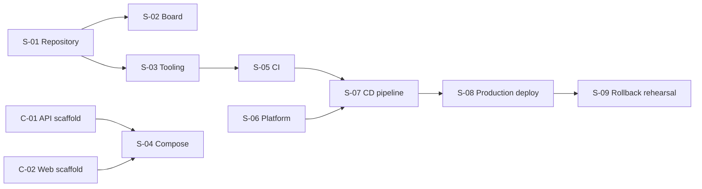

# BrewLite - Setup and DevOps Plan

**Version:** 1.0  
**Status:** Draft for team review  
**Back to:** [Overview](00-overview.md)  
**Related plans:** [Documentation](01-documentation-plan.md), [Implementation](03-implementation-plan.md), [Testing](04-testing-plan.md)

Covers the repository, tooling, Docker Compose, CI, CD, and production deployment. Column meanings are in the [overview](00-overview.md#2-how-to-read-a-plan).

## 1. Task list

| ID   | Task                                                                                                                                                                                                 | Output                                                 | Phase | Needs                  | Priority | Owner | Status |
| ---- | ---------------------------------------------------------------------------------------------------------------------------------------------------------------------------------------------------- | ------------------------------------------------------ | ----- | ---------------------- | -------- | ----- | ------ |
| S-01 | Create the repository with `apps/web`, `apps/api`, `docs`, `tests`, `.github/workflows`; branch and pull-request strategy; commit convention; Definition of Done; instructor access (A1-T1, A2-T4.1) | Repository; `CONTRIBUTING` or README section           | P0    | -                      | Must     |       | Todo   |
| S-02 | Issue board and Product Backlog for Sprint 1 and Sprint 2, populated from [00-overview.md](00-overview.md) (A2-T4.1)                                                                                 | Board with all work items                              | P0    | S-01                   | Must     |       | Todo   |
| S-03 | Shared tooling: lint, format, TypeScript config, `.gitignore`, `.env.example` with placeholders only                                                                                                 | Config files in repo                                   | P1    | S-01                   | Must     |       | Todo   |
| S-04 | `docker-compose.yml` for `web`, `api`, `db`: health checks, named volume, backend waits for healthy database (A1-T9, A2-T5.2)                                                                        | `docker-compose.yml`                                   | P2    | C-01, C-02             | Must     |       | Todo   |
| S-05 | CI on pull requests: install, lint, unit test, build; branch protection blocks merge on failure (A2-T4.4)                                                                                            | `.github/workflows/ci.yml`; evidence in section 3      | P3    | S-03, C-01, C-02       | Must     |       | Todo   |
| S-06 | Choose and provision the hosting platform: container registry, managed or private database, secrets store, HTTPS                                                                                     | Platform account and project                           | P4    | D-11 (platform ADR)    | Must     |       | Todo   |
| S-07 | CD pipeline (section 2)                                                                                                                                                                              | `.github/workflows/cd.yml`                             | P7    | S-05, S-06, C-04, T-02 | Must     |       | Todo   |
| S-08 | Production deployment: HTTPS frontend URL, API and `/health` URLs, database not public, secrets absent from repo and CI logs, release tag                                                            | Live URLs; release tag                                 | P7    | S-07, all C tasks      | Must     |       | Todo   |
| S-09 | Rehearse and document rollback                                                                                                                                                                       | Rollback steps in [../deployment.md](../deployment.md) | P7    | S-08                   | Must     |       | Todo   |

## 2. CD pipeline requirements (A2-T5.3)

The final pipeline runs: push or tag, lint and test, build, build Docker image, push to registry, deploy, smoke test. It must:

1. Run the quality gate: lint, test, build.
2. Tag images with the commit SHA or a semantic version.
3. Push the image to a container registry if the platform needs one.
4. Deploy to production using secrets held in CI.
5. Run database migrations safely.
6. Call the health check and a smoke test after deployment.
7. Stop on failure and provide a documented rollback.

## 3. CI evidence to keep (A2-T4.4)

- Link to a pull request that ran CI.
- Screenshot or log of one successful pipeline run.
- Screenshot or log of one run that caught a failure (lint, test, or build).

## 4. Local and production expectations

| Item       | Requirement                                                                                            |
| ---------- | ------------------------------------------------------------------------------------------------------ |
| Local      | `docker compose up --build -d` starts web, API, and database; see [../deployment.md](../deployment.md) |
| Config     | Secrets only in environment variables; `.env` never committed; `.env.example` has placeholders         |
| Network    | Database not exposed publicly in production; internal connection only                                  |
| Health     | `GET /health` on the API, used by Compose and the CD smoke test                                        |
| Boundaries | The production deployment diagram (D-12) must show where local, CI, and production begin and end       |

## 5. Repository structure (Assignment 2, section 9)

```text
brewlite/
|-- apps/
|   |-- web/                 # Next.js mobile-first/PWA
|   `-- api/                 # NestJS
|-- docs/
|   |-- requirements/        # A2-T1
|   |-- diagrams/            # A2-T2
|   |-- architecture/        # A2-T3 (adr/ inside)
|   |-- plans/               # this plan set
|   |-- traceability-matrix.md
|   `-- deployment.md
|-- tests/                   # Integration and E2E
|-- .github/workflows/       # CI/CD
|-- docker-compose.yml
|-- .env.example
`-- README.md
```

## 6. Dependency view

